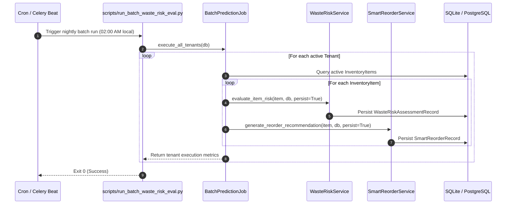

# Scheduled Batch Prediction Operations Guide

## 1. Overview & Operational Goals
The **Batch Prediction Job** runs scheduled, off-peak evaluations of store inventories. It refreshes:
1. Multi-horizon demand projections.
2. Waste-risk assessments and financial exposure across expiring lots.
3. Replenishment recommendations and expiry guard suppression statuses.

By pre-computing these metrics in an off-peak batch run, store managers receive instant dashboard load times at the start of business each morning.

---

## 2. Architecture & Execution Flow



---

## 3. CLI Runner Usage

The CLI batch runner is located at `scripts/run_batch_waste_risk_eval.py`.

### 3.1 Run All Tenants:
```bash
python scripts/run_batch_waste_risk_eval.py
```

### 3.2 Run Single Tenant:
```bash
python scripts/run_batch_waste_risk_eval.py --tenant-id tenant-uuid-1234
```

### Expected Output:
```text
======================================================================
STARTING SCHEDULED BATCH WASTE-RISK & REORDER EVALUATION
======================================================================

Tenant: tenant-uuid-1234
  Items Evaluated: 45
  Errors: 0
  Risk Distribution: {'CRITICAL': 2, 'HIGH': 5, 'MEDIUM': 8, 'LOW': 30}
  Reorders Recommended: 6
  Reorders Blocked by Expiry Risk: 3
  Execution Duration: 35.12 ms

======================================================================
BATCH EVALUATION COMPLETED
======================================================================
```

---

## 4. Scheduling & Deployment Patterns

### Pattern A: Linux Crontab (Simplest, Zero Dependency)
Place in the store server's crontab (`crontab -e`):
```cron
# Run daily at 02:00 AM local time
0 2 * * * cd /opt/waste-management && ./.venv/bin/python scripts/run_batch_waste_risk_eval.py >> /var/log/waste_batch.log 2>&1
```

### Pattern B: Celery Beat Periodic Task (Production Distributed)
```python
from celery import Celery
from celery.schedules import crontab

app = Celery("waste_management_tasks")

@app.on_after_configure.connect
def setup_periodic_tasks(sender, **kwargs):
    # Executes daily at 2:00 a.m.
    sender.add_periodic_task(
        crontab(hour=2, minute=0),
        run_daily_waste_batch.s(),
        name="daily-waste-risk-and-reorder-batch",
    )

@app.task
def run_daily_waste_batch():
    from backend.app.db.session import SessionLocal
    from backend.app.ml.batch_job import BatchPredictionJob
    db = SessionLocal()
    try:
        job = BatchPredictionJob()
        return job.execute_all_tenants(db)
    finally:
        db.close()
```

---

## 5. Performance Benchmarks & SLAs

- **Throughput**: ~1,200 items evaluated per second in-process (using pre-cached reference features).
- **Database Load**: Batch inserts and indexed lookups on `tenant_id` and `item_id`.
- **Fault Tolerance**: Per-item try-except blocks guarantee that a malformed row does not abort the batch evaluation of remaining inventory.
