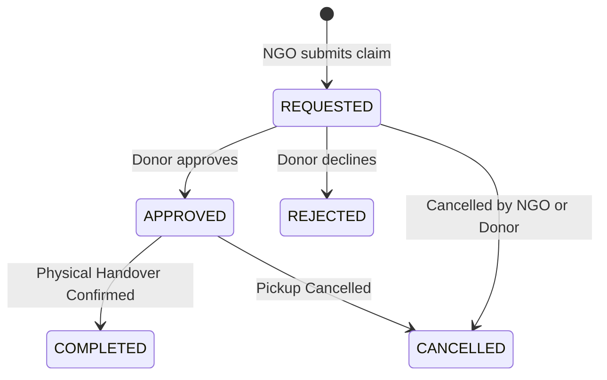

# Claim & Reservation Business Rules Specification

**Document Version:** 1.0.0  
**Phase:** Milestone 3 — Phase 1  
**Target Roles:** Full-Stack Engineers, QA Engineers, Operations Specialists

---

## 1. Overview

This document formalizes the reservation and claim workflow connecting recipient NGOs to commercial surplus food listings. It dictates how claims are requested, evaluated, approved, rejected, cancelled, and physically completed.

---

## 2. Claim State Machine

### State Transitions
1. **`REQUESTED`:** NGO indicates intent to collect a specific quantity. Earmark is held against the listing's remaining balance.
2. **`APPROVED`:** Donor reviews and authorizes collection. If cumulative approved claims equal or exceed total listing quantity, listing status transitions to `RESERVED`.
3. **`REJECTED`:** Donor declines the claim (specifying a mandatory `rejection_reason`). The reserved quantity is immediately released back to the listing's available balance.
4. **`CANCELLED`:** Either party aborts the transaction before pickup. Held stock is released.
5. **`COMPLETED`:** Physical collection confirmed. Triggers immutable stock deduction in the inventory ledger via `DONATION_DISPATCH`.

---

## 3. Strict Concurrency & Over-Claim Prevention

1. **Balance Check:**
   When a claim of quantity $Q_{\text{req}}$ is submitted:
   $$Q_{\text{req}} \le Q_{\text{listing}} - \sum Q_{\text{active\_claims}}$$
   If $Q_{\text{req}}$ exceeds remaining claimable quantity, an `ExcessiveClaimError` is raised.
2. **No Automatic Claiming:**
   The matching engine recommends candidates, but **never automatically claims food on behalf of NGOs**. Every claim requires explicit NGO submission.
3. **Role Enforcement:**
   - Only users with role `RECIPIENT_NGO` (or `SYSTEM_ADMIN`) can create claims.
   - Only donor users (`BUSINESS_OWNER`, `STORE_MANAGER`) belonging to the listing's tenant can approve or complete claims.
   - Cross-tenant approvals are blocked with HTTP 404 (preventing discovery of other businesses' claims).

---

## 4. Physical Transfer & Inventory Reconciliation

When physical food collection is confirmed via `POST /api/v1/surplus/claims/{id}/complete`:
1. `SurplusClaim.status` $\to$ `COMPLETED`.
2. The core inventory service executes `adjust_stock_quantity`:
   - `quantity_delta = -claimed_quantity`
   - `adjustment_type = TransactionType.DONATION_DISPATCH`
   - `reference_type = ReferenceType.DONATION_LISTING`
   - `reference_id = f"CLAIM:{claim.id}"`
   - `idempotency_key = f"DISPATCH_{claim.id}"`
3. If all claims against the listing have reached `COMPLETED` and total dispatched $\ge Q_{\text{listing}}$, `SurplusListing.status` $\to$ `COMPLETED`.
4. An immutable audit record `AuditEventType.SURPLUS_TRANSFER_COMPLETE` is committed.
