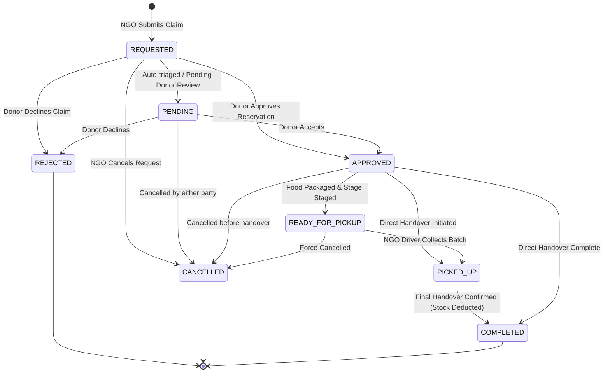

# Surplus Claim Management & Allocation Workflow
## Milestone 3 — Phase 2 Architecture & Specification

---

## 1. Executive Summary

The Claim Management Workflow governs the lifecycle of surplus food claims between **Commercial Food Donors** (Supermarkets, Bakeries, Restaurants, Food Processors) and **Verified Recipient Organizations** (Food Banks, Soup Kitchens, Community Pantries, Shelters).

It guarantees:
1. **Concurrency Safety & Anti-Oversubscription**: Ensures claimed quantities never exceed remaining unearmarked surplus balances.
2. **Explicit State Transitions**: Enforces a strict finite state machine from claim submission through physical collection and final ledger deduction.
3. **Food Safety Assurance**: Automatically checks food expiration deadlines before reservations and dispatches are confirmed.
4. **Tenant Isolation**: Guarantees donor businesses and recipient NGOs can only access and mutate claims authorized under their tenant boundary.
5. **Immutable Stock Deductions**: On physical pickup completion, triggers atomic `DONATION_DISPATCH` inventory adjustments protected by idempotency keys.

---

## 2. Claim State Machine

Claims progress through the following deterministic states:

### State Definitions & Permissions

| State | Description | Authorized Initiator | Next Valid States |
| :--- | :--- | :--- | :--- |
| `REQUESTED` | Initial claim submitted by NGO with proposed quantity and timing notes. | `RECIPIENT_NGO` | `APPROVED`, `ACCEPTED`, `REJECTED`, `CANCELLED` |
| `PENDING` | Alternative triage state awaiting operational review. | `SYSTEM`, `BUSINESS_OWNER` | `APPROVED`, `REJECTED`, `CANCELLED` |
| `APPROVED` / `ACCEPTED` | Food donor has locked and reserved the requested quantity. | `BUSINESS_OWNER`, `STORE_MANAGER` | `READY_FOR_PICKUP`, `PICKED_UP`, `COMPLETED`, `CANCELLED` |
| `READY_FOR_PICKUP` | Donor staff has packaged, labeled, and staged items at pickup dock. | `BUSINESS_OWNER`, `STORE_MANAGER`, `INVENTORY_STAFF` | `PICKED_UP`, `COMPLETED`, `CANCELLED` |
| `PICKED_UP` | NGO logistics driver has collected items; batch is in transit. | `RECIPIENT_NGO`, `BUSINESS_OWNER` | `COMPLETED` |
| `COMPLETED` | Physical handover complete. Triggers atomic `DONATION_DISPATCH` stock deduction. | `BUSINESS_OWNER`, `STORE_MANAGER` | *Terminal State* |
| `REJECTED` | Donor declined request with documented rationale. Earmark released. | `BUSINESS_OWNER`, `STORE_MANAGER` | *Terminal State* |
| `CANCELLED` | Claim withdrawn or revoked. Earmark released back to platform. | `BUSINESS_OWNER`, `RECIPIENT_NGO` | *Terminal State* |
| `EXPIRED` | Listing or claim exceeded shelf-life deadline without pickup. | `SYSTEM_SCHEDULER` | *Terminal State* |

---

## 3. Quantity Reservation & Allocation Formula

To eliminate race conditions and oversubscription:

$$\text{Claimable Balance} = \text{Listing Quantity} - \sum_{\text{active claims}} \text{Claimed Quantity}$$

Where active claims include states:
$$\text{Active Claims} \in \{\text{REQUESTED}, \text{PENDING}, \text{APPROVED}, \text{ACCEPTED}, \text{READY\_FOR\_PICKUP}, \text{PICKED\_UP}, \text{COMPLETED}\}$$

- If an incoming claim requests quantity $Q_{\text{req}} > \text{Claimable Balance}$, the backend aborts the transaction with `ExcessiveClaimError` (HTTP 400).
- If $\sum \text{Claimed Quantity} \ge \text{Listing Quantity}$, the listing automatically transitions from `AVAILABLE` to `RESERVED`.
- If an active claim is `REJECTED` or `CANCELLED`, the reservation is immediately released, returning the listing to `AVAILABLE`.

---

## 4. Physical Transfer & Inventory Ledger Reconciliation

When the donor confirms physical handover (`/api/v1/surplus/claims/{id}/complete`):
1. **Claim Status**: Moved to `COMPLETED`.
2. **Linked Pickup Schedule**: Automatically updated to `COMPLETED` with timestamp `completed_at = now()`.
3. **Stock Adjustment Request**:
   - `quantity_delta = -float(claim.claimed_quantity)`
   - `adjustment_type = TransactionType.DONATION_DISPATCH`
   - `reference_type = ReferenceType.DONATION_LISTING`
   - `reference_id = "CLAIM:{claim.id}"`
   - `idempotency_key = "DISPATCH_{claim.id}"`
4. **Immutable Transaction**: A new `StockTransaction` row is appended to the audit ledger. The commercial inventory quantity is decremented.
5. **Oversubscription Check**: If all claims for the listing reach `COMPLETED`, the entire `SurplusListing` status updates to `COMPLETED`.
6. **In-App Notification**: A `DONATION_DISPATCHED` notification is dispatched to the recipient NGO.

---

## 5. Security & Multi-Tenant Enforcement

1. **Donor Scoping**: Food business operators can only view, review, or complete claims associated with surplus listings created by their organization (`claim.listing.tenant_id == current_tenant_id`).
2. **NGO Scoping**: Recipient organizations can only view, schedule, or cancel claims initiated by their tenant profile (`claim.ngo_tenant_id == current_tenant_id`).
3. **Cross-Tenant Prevention**: Attempts to query or mutate foreign claims immediately trigger HTTP 404 / `ClaimNotFoundError`, preventing metadata leakage.
4. **Audit Logging**: Every state change records an immutable `AuditEvent` capturing actor ID, tenant ID, previous state, and updated payload.
