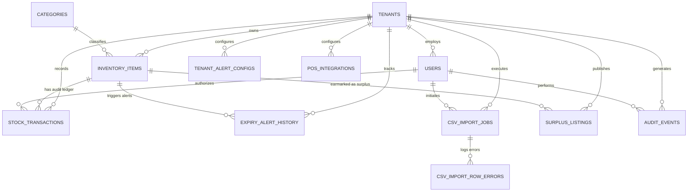

# Database Schema Specification

**Project**: AI-Powered Food Waste Management Platform for Surplus Identification and Redistribution Optimization  
**Milestone**: 1 — Inventory Management & Expiry Tracking System  
**Document**: Detailed Relational Database Schema Design  
**Phase**: Phase 1 — Detailed Design  
**Storage Engine**: Dual-Engine Architecture (PostgreSQL 16+ production, SQLite 3.49+ local development & test suite)

---

## 1. Entity-Relationship Overview

---

## 2. Table Specifications

### 2.1 `tenants` (Businesses / Organizations)
Represents commercial food businesses (supermarkets, restaurants, bakeries, wholesalers) and recipient partner organizations (NGOs, food banks).

| Column Name | Type | Constraints | Description |
| :--- | :--- | :--- | :--- |
| `id` | `VARCHAR(36)` | `PRIMARY KEY` | UUIDv4 string. |
| `name` | `VARCHAR(255)` | `NOT NULL` | Registered legal or trade name. |
| `slug` | `VARCHAR(100)` | `UNIQUE NOT NULL` | URL-friendly unique identifier (e.g., `green-grocer-downtown`). |
| `business_type` | `VARCHAR(50)` | `NOT NULL` | `SUPERMARKET`, `RESTAURANT`, `BAKERY`, `HOTEL`, `WHOLESALER`, `NGO_RECIPIENT`. |
| `contact_email` | `VARCHAR(255)` | `NOT NULL` | Primary operational contact email. |
| `phone` | `VARCHAR(50)` | `NULL` | Operational phone number. |
| `address` | `TEXT` | `NULL` | Physical facility or store address. |
| `timezone` | `VARCHAR(50)` | `DEFAULT 'UTC'` | Standard IANA timezone string (e.g., `Asia/Kolkata`, `America/New_York`). |
| `currency` | `VARCHAR(3)` | `DEFAULT 'USD'` | ISO 4217 currency code (`USD`, `EUR`, `INR`, etc.). |
| `is_active` | `BOOLEAN` | `DEFAULT TRUE` | Soft-deactivation status. |
| `created_at` | `TIMESTAMP WITH TIME ZONE` | `DEFAULT CURRENT_TIMESTAMP` | Entity registration timestamp (UTC). |
| `updated_at` | `TIMESTAMP WITH TIME ZONE` | `DEFAULT CURRENT_TIMESTAMP` | Last profile update timestamp (UTC). |

- **Indexes**:
  - `CREATE UNIQUE INDEX idx_tenants_slug ON tenants(slug);`
  - `CREATE INDEX idx_tenants_business_type ON tenants(business_type);`

---

### 2.2 `users` (User Accounts & Role-Based Access)
Stores authenticated user credentials and links each user to their tenant organization.

| Column Name | Type | Constraints | Description |
| :--- | :--- | :--- | :--- |
| `id` | `VARCHAR(36)` | `PRIMARY KEY` | UUIDv4 string. |
| `tenant_id` | `VARCHAR(36)` | `REFERENCES tenants(id) ON DELETE CASCADE` | Associated business tenant (nullable only for system super-admin). |
| `email` | `VARCHAR(255)` | `UNIQUE NOT NULL` | Login email address (stored lowercase). |
| `hashed_password` | `VARCHAR(255)` | `NOT NULL` | Bcrypt / Argon2id password hash ($cost \ge 12$). |
| `full_name` | `VARCHAR(255)` | `NOT NULL` | User's full name. |
| `role` | `VARCHAR(50)` | `NOT NULL` | `BUSINESS_OWNER`, `STORE_MANAGER`, `INVENTORY_STAFF`, `RECIPIENT_NGO`, `SYSTEM_ADMIN`. |
| `is_active` | `BOOLEAN` | `DEFAULT TRUE` | User account active flag. |
| `last_login_at` | `TIMESTAMP WITH TIME ZONE` | `NULL` | Last successful authentication timestamp. |
| `created_at` | `TIMESTAMP WITH TIME ZONE` | `DEFAULT CURRENT_TIMESTAMP` | Account creation timestamp. |
| `updated_at` | `TIMESTAMP WITH TIME ZONE` | `DEFAULT CURRENT_TIMESTAMP` | Last profile update timestamp. |

- **Indexes**:
  - `CREATE UNIQUE INDEX idx_users_email ON users(email);`
  - `CREATE INDEX idx_users_tenant_role ON users(tenant_id, role);`

---

### 2.3 `categories` (Food Taxonomy & Storage Standard)
Hierarchical food categorization catalog defining baseline perishability risks and recommended storage environments.

| Column Name | Type | Constraints | Description |
| :--- | :--- | :--- | :--- |
| `id` | `VARCHAR(36)` | `PRIMARY KEY` | UUIDv4 string. |
| `tenant_id` | `VARCHAR(36)` | `NULL REFERENCES tenants(id) ON DELETE CASCADE` | `NULL` for global system standard taxonomy; tenant UUID for custom categories. |
| `name` | `VARCHAR(100)` | `NOT NULL` | Category name (e.g., `Dairy & Eggs`, `Leafy Greens`). |
| `slug` | `VARCHAR(100)` | `NOT NULL` | Canonical slug identifier (e.g., `dairy-and-eggs`). |
| `perishability_tier` | `VARCHAR(20)` | `NOT NULL` | Enum: `CRITICAL` (1–2 days), `HIGH` (3–5 days), `MEDIUM` (1–2 weeks), `LOW` (months+). |
| `recommended_storage` | `VARCHAR(30)` | `NOT NULL` | Enum: `AMBIENT`, `REFRIGERATED`, `FROZEN`, `DRY_PANTRY`, `CLIMATE_CONTROLLED`. |
| `temp_min_celsius` | `NUMERIC(4, 1)` | `NULL` | Recommended lower temperature boundary in °C. |
| `temp_max_celsius` | `NUMERIC(4, 1)` | `NULL` | Recommended upper temperature boundary in °C. |
| `humidity_min_pct` | `NUMERIC(4, 1)` | `NULL` | Optimal lower relative humidity percentage. |
| `humidity_max_pct` | `NUMERIC(4, 1)` | `NULL` | Optimal upper relative humidity percentage. |
| `default_shelf_life_days` | `INTEGER` | `NOT NULL` | Baseline expected shelf life in days from harvest/production. |
| `description` | `TEXT` | `NULL` | Handling instructions and spoilage characteristics. |
| `created_at` | `TIMESTAMP WITH TIME ZONE` | `DEFAULT CURRENT_TIMESTAMP` | Creation timestamp. |

- **Constraints & Indexes**:
  - `CREATE UNIQUE INDEX idx_categories_system_slug ON categories(slug) WHERE tenant_id IS NULL;`
  - `CREATE UNIQUE INDEX idx_categories_tenant_slug ON categories(tenant_id, slug) WHERE tenant_id IS NOT NULL;`
  - `CREATE INDEX idx_categories_perishability ON categories(perishability_tier);`

---

### 2.4 `inventory_items` (Core Inventory Records)
The central operational table tracking current inventory lots, expiry dates, and storage conditions.

| Column Name | Type | Constraints | Description |
| :--- | :--- | :--- | :--- |
| `id` | `VARCHAR(36)` | `PRIMARY KEY` | UUIDv4 string. |
| `tenant_id` | `VARCHAR(36)` | `NOT NULL REFERENCES tenants(id) ON DELETE CASCADE` | Owning business tenant. |
| `category_id` | `VARCHAR(36)` | `NOT NULL REFERENCES categories(id)` | Associated food taxonomy category. |
| `name` | `VARCHAR(255)` | `NOT NULL` | Product name (e.g., `Organic Whole Milk 1L`). |
| `sku` | `VARCHAR(100)` | `NULL` | Stock Keeping Unit code unique within the tenant. |
| `barcode` | `VARCHAR(100)` | `NULL` | Scanned UPC-A, EAN-13, Code 128, or internal QR code string. |
| `current_quantity` | `NUMERIC(12, 2)` | `NOT NULL DEFAULT 0.00 CHECK (current_quantity >= 0)` | Available physical quantity in stock. |
| `unit` | `VARCHAR(20)` | `NOT NULL` | Measurement unit: `kg`, `g`, `liters`, `ml`, `units`, `boxes`, `packs`. |
| `cost_per_unit` | `NUMERIC(10, 2)` | `NOT NULL DEFAULT 0.00 CHECK (cost_per_unit >= 0)` | Inward acquisition cost. |
| `selling_price` | `NUMERIC(10, 2)` | `NULL CHECK (selling_price >= 0)` | Intended retail price. |
| `purchase_date` | `DATE` | `NOT NULL` | Date received or processed into inventory. |
| `expiry_date` | `DATE` | `NOT NULL` | Expiration or best-before date. |
| `batch_number` | `VARCHAR(100)` | `NULL` | Supplier batch or manufacturing lot code. |
| `storage_requirement` | `VARCHAR(30)` | `NOT NULL` | Actual storage condition: `AMBIENT`, `REFRIGERATED`, `FROZEN`, `DRY_PANTRY`. |
| `storage_location` | `VARCHAR(100)` | `NULL` | Facility location indicator (e.g., `Walk-in Chiller B`, `Rack 3-Level 2`). |
| `status` | `VARCHAR(30)` | `NOT NULL DEFAULT 'ACTIVE'` | Status: `ACTIVE`, `EXPIRING_SOON`, `EXPIRED`, `DEPLETED`, `DONATED`, `DISCARDED`. |
| `is_active` | `BOOLEAN` | `NOT NULL DEFAULT TRUE` | Soft-deletion flag. |
| `created_at` | `TIMESTAMP WITH TIME ZONE` | `DEFAULT CURRENT_TIMESTAMP` | Record creation timestamp. |
| `updated_at` | `TIMESTAMP WITH TIME ZONE` | `DEFAULT CURRENT_TIMESTAMP` | Last updated timestamp. |

- **Constraints & Indexes**:
  - `CONSTRAINT chk_expiry_after_purchase CHECK (expiry_date >= purchase_date);`
  - `CREATE UNIQUE INDEX idx_inventory_tenant_sku ON inventory_items(tenant_id, sku) WHERE sku IS NOT NULL AND is_active = TRUE;`
  - `CREATE INDEX idx_inventory_tenant_expiry ON inventory_items(tenant_id, expiry_date);`
  - `CREATE INDEX idx_inventory_tenant_barcode ON inventory_items(tenant_id, barcode) WHERE barcode IS NOT NULL;`
  - `CREATE INDEX idx_inventory_tenant_status ON inventory_items(tenant_id, status);`
  - `CREATE INDEX idx_inventory_tenant_category ON inventory_items(tenant_id, category_id);`

---

### 2.5 `stock_transactions` (Immutable Audit Ledger)
Append-only transaction ledger recording every quantity change for auditing and mathematical reconciliation.

| Column Name | Type | Constraints | Description |
| :--- | :--- | :--- | :--- |
| `id` | `VARCHAR(36)` | `PRIMARY KEY` | UUIDv4 string. |
| `tenant_id` | `VARCHAR(36)` | `NOT NULL REFERENCES tenants(id) ON DELETE CASCADE` | Owning tenant. |
| `item_id` | `VARCHAR(36)` | `NOT NULL REFERENCES inventory_items(id) ON DELETE CASCADE` | Impacted inventory item. |
| `transaction_type` | `VARCHAR(30)` | `NOT NULL` | `INITIAL_COUNT`, `RESTOCK`, `MANUAL_ADJUSTMENT`, `POS_SALE`, `SPOILAGE_DISCARD`, `DONATION_HOLD`, `DONATION_DISPATCH`, `CORRECTION`. |
| `quantity_change` | `NUMERIC(12, 2)` | `NOT NULL` | Delta: positive for additions, negative for deductions. |
| `quantity_before` | `NUMERIC(12, 2)` | `NOT NULL CHECK (quantity_before >= 0)` | Stock level prior to transaction. |
| `quantity_after` | `NUMERIC(12, 2)` | `NOT NULL CHECK (quantity_after >= 0)` | Stock level after transaction. |
| `reason` | `VARCHAR(255)` | `NULL` | Operational justification (e.g., `Broken packaging`, `Sale order #1084`). |
| `reference_type` | `VARCHAR(50)` | `NULL` | `POS_ORDER`, `CSV_IMPORT_JOB`, `DONATION_LISTING`, `MANUAL_ENTRY`. |
| `reference_id` | `VARCHAR(100)` | `NULL` | Foreign identifier linking to external event or job. |
| `created_by_user_id` | `VARCHAR(36)` | `NULL REFERENCES users(id)` | User who authorized the adjustment (null for automatic POS sync). |
| `created_at` | `TIMESTAMP WITH TIME ZONE` | `DEFAULT CURRENT_TIMESTAMP` | Immutable timestamp. |

- **Constraints & Indexes**:
  - `CONSTRAINT chk_quantity_math CHECK (quantity_after = quantity_before + quantity_change);`
  - `CREATE INDEX idx_transactions_tenant_item ON stock_transactions(tenant_id, item_id, created_at DESC);`
  - `CREATE INDEX idx_transactions_tenant_ref ON stock_transactions(tenant_id, reference_type, reference_id);`

---

### 2.6 `tenant_alert_configs` (Expiry Threshold Rules)
Customizable per-tenant alert rules configuring when inventory items trigger proactive alerts.

| Column Name | Type | Constraints | Description |
| :--- | :--- | :--- | :--- |
| `id` | `VARCHAR(36)` | `PRIMARY KEY` | UUIDv4 string. |
| `tenant_id` | `VARCHAR(36)` | `UNIQUE NOT NULL REFERENCES tenants(id) ON DELETE CASCADE` | 1-to-1 relationship with tenant. |
| `critical_threshold_hours` | `INTEGER` | `NOT NULL DEFAULT 24 CHECK (critical_threshold_hours > 0)` | Hours threshold to trigger CRITICAL urgency. |
| `warning_threshold_days` | `INTEGER` | `NOT NULL DEFAULT 3 CHECK (warning_threshold_days > 0)` | Days threshold to trigger WARNING alert. |
| `notice_threshold_days` | `INTEGER` | `NOT NULL DEFAULT 7 CHECK (notice_threshold_days > warning_threshold_days)` | Days threshold to trigger NOTICE alert. |
| `auto_flag_for_donation` | `BOOLEAN` | `NOT NULL DEFAULT TRUE` | Automatically recommend surplus donation when warning threshold is reached. |
| `email_notifications_enabled` | `BOOLEAN` | `NOT NULL DEFAULT FALSE` | Flag for daily digest or immediate email alerts. |
| `webhook_notification_url` | `VARCHAR(500)` | `NULL` | Optional external webhook for custom ERP/Slack alert notifications. |
| `updated_at` | `TIMESTAMP WITH TIME ZONE` | `DEFAULT CURRENT_TIMESTAMP` | Last updated timestamp. |

---

### 2.7 `expiry_alert_history` (Alert Lifecycle & Acknowledgment)
Logs alert events generated by the expiry calculation engine and tracks staff actions taken.

| Column Name | Type | Constraints | Description |
| :--- | :--- | :--- | :--- |
| `id` | `VARCHAR(36)` | `PRIMARY KEY` | UUIDv4 string. |
| `tenant_id` | `VARCHAR(36)` | `NOT NULL REFERENCES tenants(id) ON DELETE CASCADE` | Owning tenant. |
| `item_id` | `VARCHAR(36)` | `NOT NULL REFERENCES inventory_items(id) ON DELETE CASCADE` | Item nearing or past expiry. |
| `alert_level` | `VARCHAR(20)` | `NOT NULL` | `NOTICE`, `WARNING`, `CRITICAL`, `EXPIRED`. |
| `days_remaining` | `NUMERIC(5, 2)` | `NOT NULL` | Exact days remaining at alert generation. |
| `acknowledged` | `BOOLEAN` | `NOT NULL DEFAULT FALSE` | Staff acknowledgment flag. |
| `acknowledged_by_user_id` | `VARCHAR(36)` | `NULL REFERENCES users(id)` | User who reviewed the alert. |
| `acknowledged_at` | `TIMESTAMP WITH TIME ZONE` | `NULL` | Acknowledgment timestamp. |
| `action_taken` | `VARCHAR(50)` | `NULL` | `DISCOUNTED_FOR_SALE`, `MARKED_FOR_DONATION`, `DISCARDED`, `SNOOZED`. |
| `created_at` | `TIMESTAMP WITH TIME ZONE` | `DEFAULT CURRENT_TIMESTAMP` | Alert generation timestamp. |

- **Indexes**:
  - `CREATE INDEX idx_alerts_tenant_active ON expiry_alert_history(tenant_id, acknowledged, alert_level);`
  - `CREATE INDEX idx_alerts_tenant_item ON expiry_alert_history(tenant_id, item_id, created_at DESC);`

---

### 2.8 `csv_import_jobs` & `csv_import_row_errors` (Bulk Ingestion Tracker)
Tracks asynchronous or synchronous bulk CSV upload jobs, execution summaries, and granular row-level validation errors.

#### `csv_import_jobs`
| Column Name | Type | Constraints | Description |
| :--- | :--- | :--- | :--- |
| `id` | `VARCHAR(36)` | `PRIMARY KEY` | UUIDv4 string. |
| `tenant_id` | `VARCHAR(36)` | `NOT NULL REFERENCES tenants(id) ON DELETE CASCADE` | Ingesting tenant. |
| `filename` | `VARCHAR(255)` | `NOT NULL` | Original uploaded file name. |
| `file_size_bytes` | `INTEGER` | `NOT NULL` | Size of uploaded file. |
| `total_rows` | `INTEGER` | `NOT NULL DEFAULT 0` | Total data rows evaluated. |
| `successful_rows` | `INTEGER` | `NOT NULL DEFAULT 0` | Rows successfully committed. |
| `failed_rows` | `INTEGER` | `NOT NULL DEFAULT 0` | Rows rejected due to validation failure. |
| `status` | `VARCHAR(30)` | `NOT NULL` | `PENDING`, `VALIDATING`, `COMMITTING`, `COMPLETED`, `FAILED`, `DRY_RUN_PASSED`, `DRY_RUN_FAILED`. |
| `dry_run` | `BOOLEAN` | `NOT NULL DEFAULT FALSE` | True if run without committing database changes. |
| `allow_partial` | `BOOLEAN` | `NOT NULL DEFAULT FALSE` | If true, valid rows are committed while invalid rows are skipped. |
| `created_by_user_id` | `VARCHAR(36)` | `NOT NULL REFERENCES users(id)` | User initiating import. |
| `started_at` | `TIMESTAMP WITH TIME ZONE` | `DEFAULT CURRENT_TIMESTAMP` | Processing start timestamp. |
| `completed_at` | `TIMESTAMP WITH TIME ZONE` | `NULL` | Processing completion timestamp. |

#### `csv_import_row_errors`
| Column Name | Type | Constraints | Description |
| :--- | :--- | :--- | :--- |
| `id` | `VARCHAR(36)` | `PRIMARY KEY` | UUIDv4 string. |
| `job_id` | `VARCHAR(36)` | `NOT NULL REFERENCES csv_import_jobs(id) ON DELETE CASCADE` | Associated import job. |
| `tenant_id` | `VARCHAR(36)` | `NOT NULL REFERENCES tenants(id) ON DELETE CASCADE` | Owning tenant. |
| `row_number` | `INTEGER` | `NOT NULL` | 1-based CSV row number. |
| `raw_row_data` | `TEXT` | `NULL` | JSON string or raw CSV line snippet. |
| `field_name` | `VARCHAR(100)` | `NULL` | Column failing validation (`expiry_date`, `quantity`, etc.). |
| `invalid_value` | `VARCHAR(255)` | `NULL` | Value that caused rejection. |
| `error_code` | `VARCHAR(50)` | `NOT NULL` | Machine-readable code (`INVALID_DATE_FORMAT`, `NEGATIVE_QTY`, `UNKNOWN_CATEGORY`). |
| `error_message` | `TEXT` | `NOT NULL` | Human-readable explanation. |
| `created_at` | `TIMESTAMP WITH TIME ZONE` | `DEFAULT CURRENT_TIMESTAMP` | Error logging timestamp. |

- **Indexes**:
  - `CREATE INDEX idx_csv_jobs_tenant ON csv_import_jobs(tenant_id, started_at DESC);`
  - `CREATE INDEX idx_csv_errors_job ON csv_import_row_errors(job_id, row_number);`

---

### 2.9 `pos_integrations` (Secure POS Adapter Configurations)
Stores connection metadata for POS providers without storing plain-text secrets.

| Column Name | Type | Constraints | Description |
| :--- | :--- | :--- | :--- |
| `id` | `VARCHAR(36)` | `PRIMARY KEY` | UUIDv4 string. |
| `tenant_id` | `VARCHAR(36)` | `NOT NULL REFERENCES tenants(id) ON DELETE CASCADE` | Owning tenant. |
| `provider` | `VARCHAR(50)` | `NOT NULL` | `SQUARE`, `CLOVER`, `TOAST`, `LIGHTSPEED`, `GENERIC_REST`. |
| `integration_name` | `VARCHAR(100)` | `NOT NULL` | User-defined label (e.g., `Main Register #1`). |
| `webhook_slug` | `VARCHAR(100)` | `UNIQUE NOT NULL` | Randomized tenant webhook slug for public callback URL. |
| `api_key_hash` | `VARCHAR(64)` | `NOT NULL` | SHA-256 hash of the integration API key used by the POS adapter. |
| `webhook_secret_hash` | `VARCHAR(64)` | `NOT NULL` | SHA-256 hash of the webhook signing secret. |
| `is_active` | `BOOLEAN` | `NOT NULL DEFAULT TRUE` | Whether the integration is active. |
| `last_sync_at` | `TIMESTAMP WITH TIME ZONE` | `NULL` | Timestamp of last received event. |
| `last_error_message` | `TEXT` | `NULL` | Last integration diagnostic error. |
| `created_at` | `TIMESTAMP WITH TIME ZONE` | `DEFAULT CURRENT_TIMESTAMP` | Registration timestamp. |
| `updated_at` | `TIMESTAMP WITH TIME ZONE` | `DEFAULT CURRENT_TIMESTAMP` | Last updated timestamp. |

- **Indexes**:
  - `CREATE UNIQUE INDEX idx_pos_webhook_slug ON pos_integrations(webhook_slug);`
  - `CREATE INDEX idx_pos_tenant ON pos_integrations(tenant_id);`

---

### 2.10 `surplus_listings` (Surplus Donation Foundation for Milestones 2 & 3)
Stores food lots identified as surplus and made available for donation redistribution to partner NGOs.

| Column Name | Type | Constraints | Description |
| :--- | :--- | :--- | :--- |
| `id` | `VARCHAR(36)` | `PRIMARY KEY` | UUIDv4 string. |
| `tenant_id` | `VARCHAR(36)` | `NOT NULL REFERENCES tenants(id) ON DELETE CASCADE` | Donating business tenant. |
| `item_id` | `VARCHAR(36)` | `NOT NULL REFERENCES inventory_items(id) ON DELETE CASCADE` | Inventory item being donated. |
| `quantity` | `NUMERIC(12, 2)` | `NOT NULL CHECK (quantity > 0)` | Quantity offered for donation. |
| `unit` | `VARCHAR(20)` | `NOT NULL` | Measurement unit matching item. |
| `expiry_date` | `DATE` | `NOT NULL` | Expiry date of the offered lot. |
| `status` | `VARCHAR(30)` | `NOT NULL DEFAULT 'AVAILABLE'` | `AVAILABLE`, `RESERVED`, `CLAIMED`, `PICKED_UP`, `EXPIRED`, `CANCELLED`. |
| `pickup_address` | `TEXT` | `NOT NULL` | Facility pickup location. |
| `pickup_instructions` | `TEXT` | `NULL` | Handling details (e.g., `Bring insulated cool boxes, enter via loading dock 2`). |
| `available_from` | `TIMESTAMP WITH TIME ZONE` | `NOT NULL` | Window start time for collection. |
| `available_until` | `TIMESTAMP WITH TIME ZONE` | `NOT NULL` | Window end time (must be prior to or on expiry). |
| `claimed_by_tenant_id` | `VARCHAR(36)` | `NULL REFERENCES tenants(id)` | NGO tenant claiming the surplus (populated in Milestone 3). |
| `created_by_user_id` | `VARCHAR(36)` | `NOT NULL REFERENCES users(id)` | Authorizing user. |
| `created_at` | `TIMESTAMP WITH TIME ZONE` | `DEFAULT CURRENT_TIMESTAMP` | Creation timestamp. |
| `updated_at` | `TIMESTAMP WITH TIME ZONE` | `DEFAULT CURRENT_TIMESTAMP` | Last update timestamp. |

- **Constraints & Indexes**:
  - `CONSTRAINT chk_surplus_window CHECK (available_until > available_from);`
  - `CREATE INDEX idx_surplus_tenant_status ON surplus_listings(tenant_id, status);`
  - `CREATE INDEX idx_surplus_available_window ON surplus_listings(status, available_until);`

---

### 2.11 `audit_events` (Security & System Audit Log)
Immutable record of all security-sensitive actions across authentication, data modifications, and configurations.

| Column Name | Type | Constraints | Description |
| :--- | :--- | :--- | :--- |
| `id` | `VARCHAR(36)` | `PRIMARY KEY` | UUIDv4 string. |
| `tenant_id` | `VARCHAR(36)` | `NULL REFERENCES tenants(id) ON DELETE CASCADE` | Tenant context (null for platform-level actions). |
| `user_id` | `VARCHAR(36)` | `NULL REFERENCES users(id) ON DELETE SET NULL` | Performing user. |
| `event_type` | `VARCHAR(50)` | `NOT NULL` | `AUTH_LOGIN`, `AUTH_LOGOUT`, `INVENTORY_CREATE`, `INVENTORY_UPDATE`, `INVENTORY_DELETE`, `CSV_IMPORT`, `POS_WEBHOOK`, `ALERT_ACKNOWLEDGE`, `CONFIG_UPDATE`. |
| `resource_type` | `VARCHAR(50)` | `NOT NULL` | Target entity (`inventory_item`, `pos_integration`, `user`, etc.). |
| `resource_id` | `VARCHAR(36)` | `NULL` | Target record UUID. |
| `ip_address` | `VARCHAR(45)` | `NULL` | Client IPv4 or IPv6 address. |
| `user_agent` | `VARCHAR(255)` | `NULL` | Client browser / API agent string. |
| `payload_summary` | `TEXT` | `NULL` | JSON-encoded summary of change (with credentials redacted). |
| `created_at` | `TIMESTAMP WITH TIME ZONE` | `DEFAULT CURRENT_TIMESTAMP` | Event timestamp. |

- **Indexes**:
  - `CREATE INDEX idx_audit_tenant_time ON audit_events(tenant_id, created_at DESC);`
  - `CREATE INDEX idx_audit_event_type ON audit_events(tenant_id, event_type);`

---

## 3. Migration & Dialect Strategy

- **PostgreSQL**: Production deployment will use native `TIMESTAMP WITH TIME ZONE`, `NUMERIC`, `UUID`, and foreign key cascades.
- **SQLite**: Local development and automated testing utilize SQLite's dynamic typing with strict affinity conventions:
  - Timestamps stored as ISO-8601 UTC strings (`YYYY-MM-DDTHH:MM:SSZ`).
  - Dates stored as ISO-8601 strings (`YYYY-MM-DD`).
  - Decimals stored as `REAL` or string-exact numbers.
  - Foreign key constraints enabled automatically on session connection: `PRAGMA foreign_keys = ON;`.
  - Write-Ahead Logging enabled for high-concurrency read/write: `PRAGMA journal_mode = WAL;`.
