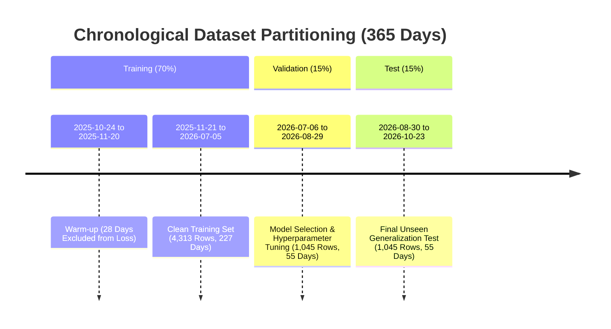

# Dataset Versioning & Lineage Specification

**Project**: AI-Powered Food Waste Management Platform for Surplus Identification and Redistribution Optimization  
**Milestone**: 2 — Machine Learning Demand Forecasting & Food Waste Prediction  
**Phase**: Phase 2 — Data Cleaning, Preprocessing, Feature Engineering & ML-Ready Dataset Generation  
**Dataset Release**: `v2.0.0-phase2`  
**Date**: October 24, 2026  
**Auditor**: Senior Machine Learning Engineer, Data Engineer, MLOps Engineer  

---

## 1. Cryptographic File Signatures (SHA-256)

All dataset files across the raw, interim, and processed tiers are cryptographically hashed using SHA-256. Any pipeline re-run on unchanged inputs guarantees bit-for-bit identical outputs.

### Comprehensive File Register

| Tier | File Path | Format | Record Count | SHA-256 Checksum | Purpose / Description |
| :--- | :--- | :---: | :---: | :--- | :--- |
| **Raw** | `data/raw/synthetic_daily_supermarket_history.csv` | CSV | 6,935 | `82e001c2c7b95dad990351348339a49db43031d5122a6835f03c685e75266e3d` | Immutable 365-day supermarket benchmark history (19 SKUs, 10 categories) |
| **Raw** | `data/raw/synthetic_transactions_supermarket_history.csv` | CSV | 8,617 | `628abb2fe20e67fb250af82cd33330cbe6edb75133b39124eaa17a169ff517d0` | Immutable transaction ledger events with controlled anomalies |
| **Interim** | `data/interim/cleaned_transactions.csv` | CSV | 8,616 | `5dbe1fb2b5381cc290abd0dc24213aae22a855a2029d81a56c1128da5bc2422a` | Cleaned transactions (deduplicated, unit-normalized, ledger-reconciled) |
| **Interim** | `data/interim/daily_time_series_grid.csv` | CSV | 6,935 | `d276d4d024ebc581d02ea49f271a1df44513045aefcb35971abcbf3ebfc331b7` | Gap-free continuous daily grid with Syntetos-Boylan demand tags |
| **Processed** | `data/processed/train_features.csv` | CSV | 4,313 | `49ea168855b71a5be7f9092fc354b6527216def76b7cf0a095421d49300291bf` | Training partition (70% timeline, warm-up excluded, fitted scaler applied) |
| **Processed** | `data/processed/val_features.csv` | CSV | 1,045 | `51370d35bd7591a9e4acab39fbbf574669814b5ee615bbdc95eac2ac1dd3e5ab` | Validation partition (15% timeline, statelessly scaled) |
| **Processed** | `data/processed/test_features.csv` | CSV | 1,045 | `fc1b0bdf62c589a0cce17cbb6a2cf4aaac851d339cd24dbcc631f430be51d586` | Held-out test partition (15% timeline, statelessly scaled) |
| **Processed** | `data/processed/cleaning_summary.json` | JSON | — | — | Machine-readable audit log of all data cleaning transformations |
| **Processed** | `data/processed/dataset_version_metadata.json` | JSON | — | — | Complete MLOps metadata artifact including feature means, scales, and boundaries |

---

## 2. Chronological Partition Boundaries

The temporal splits strictly forbid random data shuffling to preserve temporal integrity:



### Boundary Alignment Invariants:
1. $\max(\text{Dates}_{\text{train}}) = \text{2026-07-05} < \min(\text{Dates}_{\text{val}}) = \text{2026-07-06}$
2. $\max(\text{Dates}_{\text{val}}) = \text{2026-08-29} < \min(\text{Dates}_{\text{test}}) = \text{2026-08-30}$
3. $\text{Dates}_{\text{train}} \cap \text{Dates}_{\text{val}} = \emptyset$
4. $\text{Dates}_{\text{val}} \cap \text{Dates}_{\text{test}} = \emptyset$
5. $\text{Dates}_{\text{train}} \cap \text{Dates}_{\text{test}} = \emptyset$

---

## 3. Preprocessing Parameter Isolation

To prevent lookahead leakage in feature scaling:
- `StandardScaler` is fitted **strictly on `train_features.csv`** (after dropping warm-up rows).
- Validation and Test sets are transformed **statelessly** using the stored training parameters:

$$\mu_{\text{train}} = \frac{1}{N_{\text{train}}}\sum_{i=1}^{N_{\text{train}}} x_{i, \text{train}}, \quad \sigma_{\text{train}} = \sqrt{\frac{1}{N_{\text{train}}}\sum_{i=1}^{N_{\text{train}}} (x_{i, \text{train}} - \mu_{\text{train}})^2}$$

$$x_{\text{scaled}} = \frac{x - \mu_{\text{train}}}{\sigma_{\text{train}}}$$

These parameters are exported in `data/processed/dataset_version_metadata.json` for reproducible reloading during model serving in Phase 4.

---

## 4. Instructions for Deterministic Reproduction

To independently reproduce all datasets from scratch:

```bash
# 1. Activate project virtual environment
.\.venv\Scripts\Activate.ps1

# 2. Execute end-to-end preprocessing pipeline
python scripts/run_ml_preprocessing_pipeline.py

# 3. Execute automated validation test suite
pytest -v backend/tests/test_ml_preprocessing_pipeline.py
```
