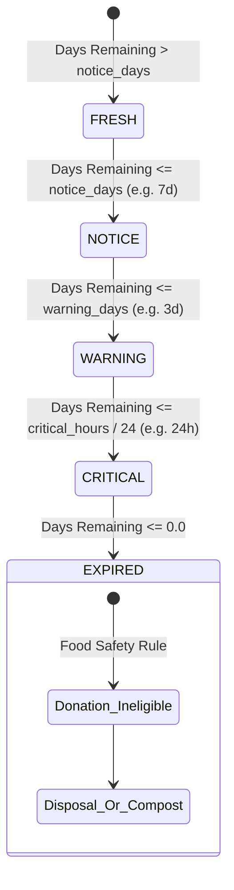

# Expiry Evaluation Engine & Dynamic Classification Architecture

**Project**: AI-Powered Food Waste Management Platform for Surplus Identification and Redistribution Optimization  
**Milestone**: 1 — Inventory Management & Expiry Tracking System  
**Phase**: Phase 5 — Expiry Tracking, Food Classification and Alert Engine  
**Status**: APPROVED SPECIFICATION  

---

## 1. Timezone-Aware Calculation Model

### 1.1 Date Anchor Strategy
Expiration dates are typically tracked at the calendar date level (`YYYY-MM-DD`). To prevent premature expiration or time-zone confusion:
1. Every inventory item's `expiry_date` is interpreted in the context of the owning tenant's configured IANA timezone (e.g. `America/New_York`, `Asia/Kolkata`, `UTC`).
2. An item expiring on date $D$ remains physically valid throughout that full calendar day. Expiry is mathematically anchored at the final microsecond of that day:
   $$T_{\text{expiry}} = \text{combine}(D, 23:59:59.999999, \text{tz}=\text{tenant.timezone})$$
3. Fractional days remaining is calculated relative to the exact evaluation moment $T_{\text{eval}}$:
   $$\Delta t = \frac{T_{\text{expiry}} - T_{\text{eval}}}{86400.0}$$

---

## 2. Multi-Tier Expiry State Machine



### 2.1 Threshold Rules & Dynamic Classification

| Calculated Days Remaining ($\Delta t$) | Alert Level | Action Recommended | Surplus Donation Eligible? | Description |
| :--- | :---: | :--- | :---: | :--- |
| $\Delta t \le 0.0$ | **`EXPIRED`** | `DISCARD` / `COMPOST` | **STRICTLY FALSE** | Expiration moment has elapsed. Food safety hazard. Forbidden from donation feeds. |
| $0.0 < \Delta t \le \frac{\text{crit\_hours}}{24}$ | **`CRITICAL`** | `EXPEDITE_REDUCTION` / `IMMEDIATE_DONATION` | **TRUE** | Within final critical window (default $\le 24$ hours). Urgent surplus triage. |
| $\frac{\text{crit\_hours}}{24} < \Delta t \le \text{warn\_days}$ | **`WARNING`** | `MARK_DOWN_PRICE` / `LIST_FOR_DONATION` | **TRUE** | Approaching expiration (default $\le 3$ days). Promotional discount or NGO listing. |
| $\text{warn\_days} < \Delta t \le \text{notice\_days}$ | **`NOTICE`** | `MONITOR_STOCK` / `FIRST_IN_FIRST_OUT` | **TRUE** | Approaching review threshold (default $\le 7$ days). Highlight for inventory rotation. |
| $\Delta t > \text{notice\_days}$ | **`FRESH`** | `STANDARD_STORAGE` | **TRUE** | Optimal quality; no immediate risk. |

---

## 3. Critical Food Safety Contract

$$\Delta t \le 0.0 \implies \mathbf{donation\_eligible} = \mathbf{False}$$

This food safety rule is strictly implemented in [`backend/app/services/expiry_service.py`](file:///D:/Waste%20management/backend/app/services/expiry_service.py#L98-L105):
```python
if days_remaining <= 0.0:
    return (
        AlertLevel.EXPIRED.value,
        AlertAction.DISCARD.value,
        False,  # STRICT FOOD SAFETY RULE: Expired items NEVER eligible for donation
    )
```

---

## 4. Alert Deduplication & Escalation Strategy

To prevent alert fatigue and spam while ensuring urgent escalations are captured:
1. **Uniqueness**: A historical alert is identified by `(tenant_id, item_id)`.
2. **24-Hour Cooldown**: If an active unacknowledged alert of the *same level* was generated within the prior 24 hours, duplicate creation is suppressed.
3. **Immediate Escalation**: If an item degrades from `WARNING` to `CRITICAL` or `EXPIRED`, the level transition immediately bypasses the 24-hour suppression and logs a new high-priority alert record.
4. **Acknowledged Status**: Acknowledging an alert silences subsequent duplicate generation for that level.
