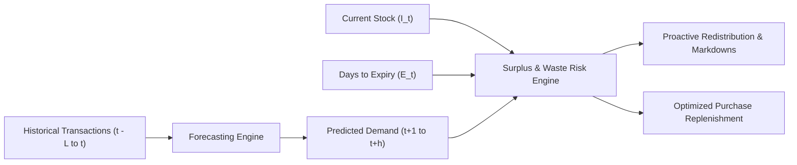
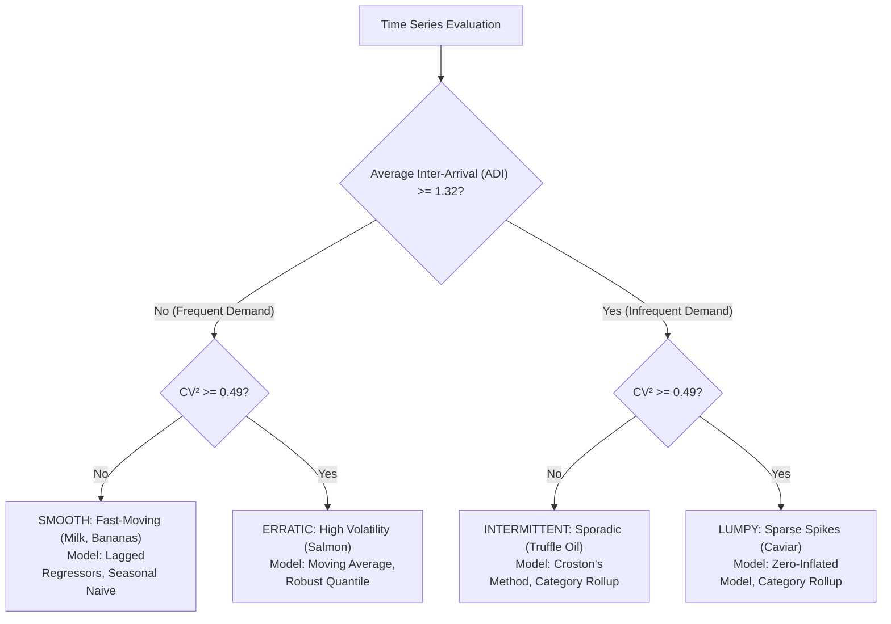

# Forecasting Problem Definition & Target Specifications

**Project**: AI-Powered Food Waste Management Platform for Surplus Identification and Redistribution Optimization  
**Milestone**: 2 — Machine Learning Demand Forecasting & Food Waste Prediction  
**Phase**: Phase 1 — Dataset Audit, Raw Data Profiling and ML Pipeline Design  
**Date**: October 23, 2026  
**Auditor**: Senior Machine Learning Engineer, Statistical Evaluator  

---

## 1. Problem Formulation

The primary operational objective of the forecasting engine is to predict future product-level customer demand to:
1. **Prevent Food Waste**: Identify excess stock that will not sell before its expiration date, enabling proactive discount markdowns and food bank donation dispatch.
2. **Prevent Stockouts**: Compute statistically grounded reorder points so merchants replenish inventory before running out of stock.

---

## 2. Granularity, Frequency & Prediction Horizons

### 2.1 Forecast Unit
- **Primary Forecast Grain**: `(tenant_id, sku, date)` — Individual product SKU at the specific store tenant location.
- **Hierarchical Secondary Grain**: `(tenant_id, category_id, date)` — Aggregated category level used for sparse/intermittent products, high-level procurement planning, and storage capacity allocation.

### 2.2 Forecast Frequency
- **Daily ($\Delta t = 1 \text{ day}$)**: Default operational cadence required for fresh and perishable food items where shelf life is between 2 and 7 days.
- **Weekly ($\Delta t = 7 \text{ days}$)**: Strategic replenishment planning for long-life pantry, frozen, and dry goods.

### 2.3 Forecast Horizons ($h$)
| Horizon Tier | Horizon Span ($h$) | Target Food Categories | Shelf-Life Dynamics | Primary Action Triggered |
| :--- | :---: | :--- | :--- | :--- |
| **Short-Term (Perishable)** | **1 to 7 Days** | Fresh Produce, Meat & Poultry, Seafood, Bakery, Deli | Shelf life 2–7 days | Dynamic discounting, food bank surplus listing |
| **Medium-Term (Semi-Perishable)**| **8 to 14 Days** | Dairy & Eggs, Refrigerated Prepared Meals | Shelf life 14–21 days | Lead-time supplier reorders |
| **Long-Term (Shelf-Stable)** | **15 to 28 Days** | Pantry & Dry Goods, Frozen Foods, Beverages, Snacks | Shelf life 90–180+ days | Bulk replenishment, warehouse capacity management |

---

## 3. Target Variable & Censored Demand Handling

### 3.1 Primary Target ($y_t$)
- **Metric**: Daily total recorded sales volume ($\text{sales\_quantity}_t$).
- **Measurement Unit**: Preserved in the product's canonical unit (`kg`, `liters`, `units`, `packs`).
- **Mathematical Form**:
  $$y_{i,t} = \sum_{\tau \in \text{Day } t} | \Delta q_{\tau} | \quad \text{where } \text{type}_{\tau} = \text{POS\_SALE} \text{ and SKU} = i$$

### 3.2 Censored Demand vs. True Customer Demand
- **The Censoring Trap**: When inventory drops to zero ($I_t = 0$), recorded sales are identically zero ($y_t = 0$), even if 50 customers wanted to buy the item. Training ML models directly on raw sales without stockout indicators causes the model to learn that demand vanishes, permanently under-forecasting fast-selling items.
- **Formulation**:
  $$y_{t} = \min(D_{t}, I_{t})$$
  where $D_t$ is true unobservable latent customer demand and $I_t$ is available inventory.
- **Pipeline Treatment**:
  1. The feature engineering pipeline includes an explicit binary feature `was_stockout_yesterday = (I_{t-1} == 0)`.
  2. For evaluation, periods with verified stockouts ($I_t = 0$) are masked or flagged during error computation so the model is not penalized for failing to predict zero sales on an empty shelf.

---

## 4. Calendar, Timezone & Zero-Demand Specifications

### 4.1 Business Timezone
- All day boundaries are anchored strictly to the tenant's configured local timezone (`tenant.timezone`, e.g. `America/New_York`, `Asia/Kolkata`).
- Observation timestamp cutoff is at `23:59:59.999999` local time.

### 4.2 Closed Days & Trading Hours
- If a retail store is closed on Sundays or national holidays, customer demand is structurally zero.
- The pipeline introduces `is_store_open` binary calendar feature. Models are trained to recognize zero-demand on scheduled closure days without distorting weekday baseline parameters.

### 4.3 Missing Days & Continuous Grid Guarantee
- Missing calendar dates in raw sales tables must **NEVER** be dropped. Dropping missing dates corrupts lag distance (e.g. making $t-7$ represent 10 days ago).
- The pipeline builds a complete continuous date grid using `pd.date_range()` and imputes unobserved sales with `0.0` while forward-filling closing stock balances.

---

## 5. Sparsity & Intermittent Demand Handling

Based on the Syntetos-Boylan classification verified in the data profiling audit:

### Sparsity Thresholds
- **Candidate for Product-Level Daily Regression**: Zero-demand days $< 70\%$ and $\text{ADI} < 1.32$.
- **Sparse / Intermittent Items**: Zero-demand days $\ge 70\%$ or $\text{ADI} \ge 1.32$.
  - These items are either:
    1. Modeled using Croston's intermittent method (separating demand size from arrival probability).
    2. Aggregated to the category level for general replenishment forecasting.
