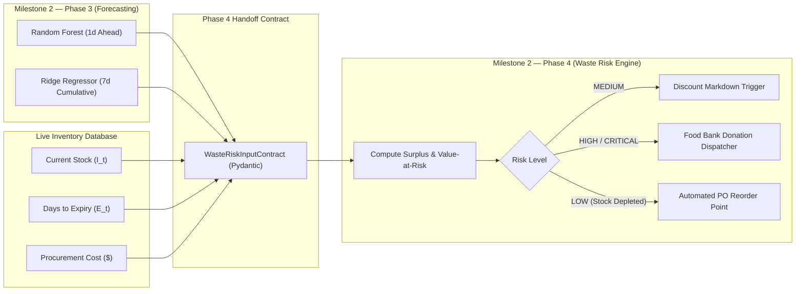

# Forecast Output & Downstream Waste-Risk Contract Specification

**Project**: AI-Powered Food Waste Management Platform for Surplus Identification and Redistribution Optimization  
**Milestone**: 2 — Machine Learning Demand Forecasting & Food Waste Prediction  
**Phase**: Phase 3 — Forecasting Model Development, Training & Evaluation  
**Date**: October 24, 2026  
**Auditor**: Senior Machine Learning Engineer, Backend Integration Engineer, System Architect  

---

## 1. Interface Architecture Overview

The forecasting models developed in Milestone 2, Phase 3 generate predictions that feed directly into the **Waste-Risk Scoring and Surplus Redistribution Engine** (Milestone 2, Phase 4).



---

## 2. Forecast Output Contract (`SKUForecastResult`)

Generated by [`backend/app/ml/forecast_contract.py`](file:///D:/Waste%20management/backend/app/ml/forecast_contract.py):

### 2.1 Pydantic Model Schema
```python
class DailyForecastPoint(BaseModel):
    date: str = Field(..., description="Forecast date (YYYY-MM-DD)")
    predicted_sales: float = Field(..., ge=0.0, description="Point forecast in physical canonical units")
    lower_bound_80: float = Field(0.0, ge=0.0, description="80% prediction interval lower bound")
    upper_bound_80: float = Field(0.0, ge=0.0, description="80% prediction interval upper bound")

class SKUForecastResult(BaseModel):
    sku: str = Field(..., description="Unique product SKU")
    tenant_id: str = Field(..., description="Store tenant identifier")
    product_name: str = Field(..., description="Product display name")
    unit: str = Field(..., description="Platform canonical measurement unit (kg, liters, packs)")
    horizon_days: int = Field(..., description="Forecast horizon span (e.g. 7 days)")
    daily_forecasts: List[DailyForecastPoint] = Field(..., description="Sequence of daily point forecasts")
    predicted_7d_demand: float = Field(..., ge=0.0, description="Cumulative 7-day expected sales volume")
    model_name: str = Field(..., description="Identifier of the serving forecasting model")
    model_version: str = Field(..., description="Model release version")
    generated_at: str = Field(..., description="ISO timestamp of forecast generation")
```

### 2.2 JSON Example Payload
```json
{
  "sku": "DAI-MILK-01",
  "tenant_id": "tenant-greengrocer-01",
  "product_name": "Organic Whole Milk 1 Gal",
  "unit": "liters",
  "horizon_days": 7,
  "daily_forecasts": [
    {"date": "2026-10-25", "predicted_sales": 22.4, "lower_bound_80": 19.1, "upper_bound_80": 25.7},
    {"date": "2026-10-26", "predicted_sales": 18.2, "lower_bound_80": 15.0, "upper_bound_80": 21.4},
    {"date": "2026-10-27", "predicted_sales": 17.9, "lower_bound_80": 14.8, "upper_bound_80": 21.0},
    {"date": "2026-10-28", "predicted_sales": 19.5, "lower_bound_80": 16.2, "upper_bound_80": 22.8},
    {"date": "2026-10-29", "predicted_sales": 20.1, "lower_bound_80": 16.9, "upper_bound_80": 23.3},
    {"date": "2026-10-30", "predicted_sales": 26.8, "lower_bound_80": 23.0, "upper_bound_80": 30.6},
    {"date": "2026-10-31", "predicted_sales": 28.5, "lower_bound_80": 24.5, "upper_bound_80": 32.5}
  ],
  "predicted_7d_demand": 153.4,
  "model_name": "RidgeForecaster",
  "model_version": "2.0.0-phase3",
  "generated_at": "2026-10-24T09:52:35.120"
}
```

---

## 3. Waste-Risk Engine Input Contract (`WasteRiskInputContract`)

In Milestone 2, Phase 4, the waste risk scoring engine requires the forecast combined with live inventory state:

```python
class WasteRiskInputContract(BaseModel):
    sku: str = Field(..., description="Product SKU")
    tenant_id: str = Field(..., description="Store tenant identifier")
    current_stock: float = Field(..., ge=0.0, description="Current physical shelf stock balance (I_t)")
    shelf_life_days: float = Field(..., ge=1.0, description="Expected biological shelf life in days")
    days_to_expiry: float = Field(..., ge=0.0, description="Remaining days until batch expiration")
    unit_cost: float = Field(..., ge=0.0, description="Procurement unit cost ($)")
    selling_price: float = Field(..., ge=0.0, description="Current shelf selling price ($)")
    predicted_demand_to_expiry: float = Field(..., ge=0.0, description="Cumulative forecast demand across remaining expiry days")
    predicted_7d_demand: float = Field(..., ge=0.0, description="Cumulative 7-day forecast demand")
    lead_time_days: int = Field(default=2, ge=1, description="Supplier delivery lead time in days")
```

---

## 4. Waste-Risk Engine Output Contract (`WasteRiskOutputContract`)

Phase 4 will generate the following structured operational recommendation:

```python
class WasteRiskOutputContract(BaseModel):
    sku: str = Field(...)
    tenant_id: str = Field(...)
    risk_level: str = Field(..., description="LOW, MEDIUM, HIGH, CRITICAL")
    expected_surplus_quantity: float = Field(..., ge=0.0, description="max(0, current_stock - predicted_demand)")
    surplus_ratio: float = Field(..., ge=0.0, le=1.0, description="surplus / current_stock")
    value_at_risk: float = Field(..., ge=0.0, description="expected_surplus * unit_cost")
    reorder_point: float = Field(..., ge=0.0, description="Statistical safety stock + lead-time demand")
    recommended_action: str = Field(..., description="NONE, DISCOUNT_MARKDOWN, DONATE_SURPLUS, REORDER_NOW")
```

---

## 5. Edge Cases & Resilience Safeguards

1. **Missing Batch Expiry Date**: If a stock item lacks an explicit batch expiration date, the engine falls back to `days_to_expiry = shelf_life_days`.
2. **Current Stock is Zero ($I_t = 0$)**: Surplus quantity is immediately $0.0$; risk level is `LOW`, and action defaults to `REORDER_NOW` based on `predicted_7d_demand`.
3. **Predicted Demand is Zero**: If forecast demand across the expiry window is $0.0$, the entire current stock is flagged as surplus (`surplus_ratio = 1.0`, risk level `HIGH` or `CRITICAL`).
4. **Physical Non-Negativity Invariant**: Predicted demand and surplus quantities are strictly non-negative ($\ge 0.0$).
