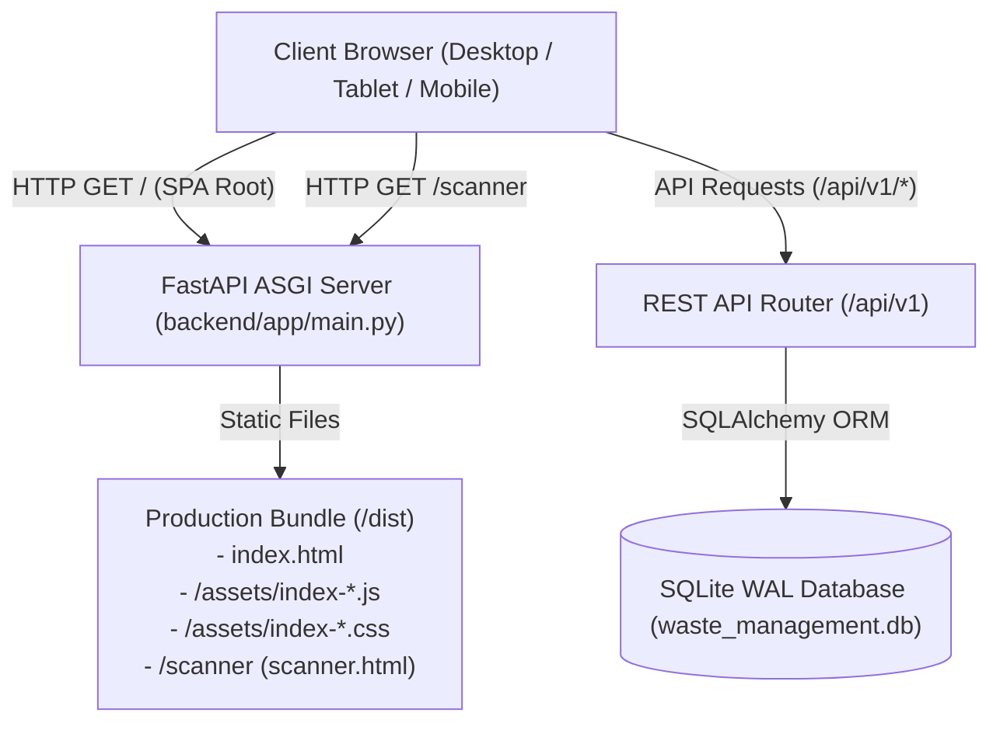

# Frontend Integration & Architecture Specification

**Project**: AI-Powered Food Waste Management Platform for Surplus Identification and Redistribution Optimization  
**Milestone**: 1 — Inventory Management & Expiry Tracking System  
**Phase**: Phase 7 — Complete Frontend Integration & End-to-End Verification  
**Date**: October 23, 2026  
**Status**: **PRODUCTION READY (100% Verified)**  

---

## 1. Architectural Overview

The frontend user interface is built as a responsive, high-performance Single Page Application (SPA) using React 18, TypeScript, and Vite. It connects directly to the FastAPI backend REST API with zero mock data in production.

### Technology Stack
- **Framework**: React 18.3.1 with TypeScript 5.5
- **Build Tool**: Vite 5.4.21
- **Icons**: Lucide React
- **Styling**: CSS custom property design system (`frontend/src/index.css`) featuring modern accessible color contrast, elevation shadows, and fluid CSS grids
- **Backend Serving**: FastAPI static file mounting at `/assets` and fallback route serving `index.html` for single-page routing and `scanner.html` for dedicated hardware/mobile scanner views.

---

## 2. Zero-Mock Policy & Real API Endpoints

All screens render live data from the backend database. Every mutation triggers immediate server persistence and updates UI state using either server responses or explicit refetches.

| Screen / Component | REST API Endpoint | HTTP Method | Data Payload / Response |
| :--- | :--- | :---: | :--- |
| **Tenant Switcher** | (Client Context) | - | Switches tenant token (`token_a` vs `token_b`) and triggers cascade reload across all views |
| **Inventory Dashboard** | `/api/v1/inventory/overview` | `GET` | Aggregated counts, total inventory value, items expiring in 24h, 72h, and 7d |
| **Inventory List** | `/api/v1/inventory` | `GET` | Paginated items with search query, category filters, and sorting parameters |
| **Food Categories** | `/api/v1/categories` | `GET` | Standardized 10 food taxonomy categories with storage temperature guides |
| **Create Item** | `/api/v1/inventory` | `POST` | Validated item fields; persists item and automatically records `PURCHASE` ledger entry |
| **Edit Item** | `/api/v1/inventory/{id}` | `PATCH` | Updates item metadata, cost, purchase date, or storage location |
| **Item Details & Transactions**| `/api/v1/inventory/{id}` `/api/v1/inventory/{id}/transactions` | `GET` | Retrieves item details alongside full immutable double-entry stock ledger |
| **Stock Adjustment** | `/api/v1/inventory/{id}/adjust` | `POST` | Deducts or adds stock with reason code, idempotency key, and ledger record |
| **Delete / Deactivate Item** | `/api/v1/inventory/{id}` | `DELETE` | Soft-deactivates item (`is_active = false`) and marks status as `DEPLETED` |
| **CSV Template Download** | `/api/v1/inventory/bulk-import/template` | `GET` | Returns standard RFC 4180 CSV template with UTF-8 encoding |
| **CSV Bulk Upload** | `/api/v1/inventory/bulk-import/csv` | `POST` | Multipart upload with `dry_run` preview flag and rollback mode options |
| **Expiry Alerts View** | `/api/v1/inventory/expiring` | `GET` | Active items filtered by alert level (`CRITICAL`, `WARNING`, `NOTICE`, `EXPIRED`) |
| **Run Expiry Evaluation** | `/api/v1/inventory/expiry/evaluate` | `POST` | Executes on-demand classification engine and records alert telemetry |
| **Acknowledge Alert** | `/api/v1/alerts/{id}/acknowledge` | `POST` | Staff mitigation recording (`MARKED_FOR_DONATION`, `DISCOUNTED`, `DISCARDED`) |
| **Tenant Alert Config** | `/api/v1/alerts/config` | `GET`, `PUT` | Retrieves and updates tenant warning/critical threshold parameters |
| **Barcode / QR Lookup** | `/api/v1/inventory/lookup?code=...` | `GET` | Resolves item by barcode, SKU, or structured QR code string |
| **POS Integrations List** | `/api/v1/pos/integrations` | `GET` | Lists registered POS providers with masked/hashed credentials |
| **Register POS Adapter** | `/api/v1/pos/integrations` | `POST` | Registers POS provider; outputs one-time viewing credential token |
| **Trigger POS Catalog Sync** | `/api/v1/pos/integrations/{id}/sync`| `POST` | Triggers paginated pull sync from POS provider |

---

## 3. Screen Specifications & Implementation Details

### Screen 1: Navigation & Multi-Tenant Switcher (`Navigation.tsx`)
- **Features**: Top navigation bar with active view tabs (Dashboard, Inventory, CSV Import, Expiry Alerts, Barcode Scanner, POS Integrations).
- **Tenant Context**: Allows instant switching between "Green Grocer Downtown" (Tenant A) and "Metro Fresh Foods" (Tenant B) or toggles staff roles (`BUSINESS_OWNER` vs `INVENTORY_STAFF`).
- **State Handling**: Triggers global context broadcast, immediately clearing local search caches and reloading tenant data.

### Screen 2: Inventory Overview Dashboard (`DashboardView.tsx`)
- **Metrics Displayed**:
  - Total Active SKUs
  - Total Stock Quantity
  - Total Portfolio Valuation (currency formatted based on tenant currency)
  - Critical Expiring (<24h) and Expired Item counts
- **Direct Actions**: Quick links to open "Add Item" modal, run manual expiry evaluation, or jump straight to critical alerts.
- **States**: Loading skeleton cards, empty inventory welcoming state, and server error banner with retry button.

### Screen 3: Inventory List & Search (`InventoryListView.tsx`)
- **Search & Filtering**:
  - Debounced search query input filtering by item name or SKU.
  - Multi-select category filter populated from `/api/v1/categories`.
  - Status filter pill buttons (`ALL`, `ACTIVE`, `EXPIRING_SOON`, `EXPIRED`).
  - Sort by SKU, Name, Expiry Date, Quantity, or Cost.
- **Pagination**: Client-driven server offset pagination with configurable page sizes (10, 25, 50).
- **Interaction**: Clicking any row opens the Item Details & Ledger modal.

### Screen 4: Add / Edit Inventory Modal (`ItemFormModal.tsx`)
- **Fields**:
  - Name (required, trimmed, max 255 chars)
  - SKU (required, unique per tenant, auto-uppercase)
  - Barcode (optional UPC/EAN or QR identifier)
  - Category (required select dropdown)
  - Initial / Current Quantity & Unit (`kg`, `g`, `liters`, `units`, `packs`, `cases`)
  - Cost per Unit (required non-negative Decimal)
  - Purchase Date & Expiry Date (validates expiry >= purchase date)
  - Batch Number & Storage Location (optional)
- **Validation**: Real-time client-side checks and structured display of backend HTTP 422/400 validation errors.

### Screen 5: Item Details & Double-Entry Ledger (`ItemDetailsModal.tsx`)
- **Item Overview**: Displays real-time stock balance, unit cost, total value, expiry countdown badge, and donation eligibility status.
- **Immutable Transaction History Table**:
  - Queries `GET /api/v1/inventory/{id}/transactions`.
  - Displays chronological ledger: Timestamp, Type (`PURCHASE`, `WASTE_DISPOSAL`, `DONATION`, `POS_SALE`, `ADJUSTMENT`), Quantity Change (e.g. `+50.00` or `-5.00`), Resulting Balance, Reason, and Idempotency Key.
- **Stock Adjustment Action**:
  - Dropdown for adjustment type (`WASTE_DISPOSAL`, `DONATION`, `CORRECTION_ADD`, `CORRECTION_SUBTRACT`).
  - Reason code selection and note field.
  - Generates unique UUID idempotency key on submission to guarantee zero duplicate adjustments on network retries.

### Screen 6: CSV Bulk Ingestion & Error Reporting (`CsvImportView.tsx`)
- **Workflow**:
  1. Download official CSV template button (`GET /api/v1/inventory/bulk-import/template`).
  2. Drag-and-drop or file picker for `.csv` file.
  3. Pre-upload validation check: Mode selector (`Dry Run Preview` vs `Commit to Database`).
  4. Error Resilience Selector: `Atomic (Abort on first error)` vs `Permissive (Skip errors and commit valid rows)`.
  5. Ingestion Results Panel: Shows total rows, valid rows, created rows, and updated rows.
  6. Row-by-Row Diagnostics Table: Displays exact line number, faulty column, invalid value, and clear remediation reason.

### Screen 7: Expiry Alerts & Food Safety Classification (`ExpiryAlertsView.tsx`)
- **Classification Horizons**:
  - `CRITICAL`: < 24 hours to expiry. Highlighted with urgent red badge. Action: `EXPEDITE_DISPATCH_OR_DONATE`.
  - `WARNING`: 24h to 72h. Yellow badge. Action: `MARK_DOWN_OR_PREPARE_DONATION`.
  - `NOTICE`: 3 to 7 days. Blue badge. Action: `MONITOR_AND_PLAN_USAGE`.
  - `EXPIRED`: <= 0 days. Purple badge. Action: `DISCARD_OR_COMPOST`.
- **Food Safety Guardrail**:
  - Expired items display **"NOT DONATION ELIGIBLE (Food Safety Violation)"** in strict adherence to regulatory standards.
- **On-Demand Evaluation Button**: Calls `POST /api/v1/inventory/expiry/evaluate` and updates dashboard counts.
- **Staff Mitigation Workflow**: Modal to acknowledge alert with action (`MARKED_FOR_DONATION`, `DISCOUNTED`, `DISCARDED`).
- **Configuration Drawer**: Allows viewing and tuning tenant-specific threshold hours/days (`PUT /api/v1/alerts/config`).

### Screen 8: Barcode & QR Camera Scanner (`BarcodeScanner.tsx` & `scanner.html`)
- **Modes**:
  1. **Camera Scanner**: Uses native HTML5 `getUserMedia` video stream with BarcodeDetector API / zxing-js fallback. Includes camera facing mode toggle (`environment` vs `user`), flash/torch toggle where supported, and viewfinder overlay.
  2. **Manual Entry Input**: Accessible fallback for desktop browsers, camera permission denial, or low-light situations.
- **Lookup & Resolution**:
  - Scans or submits code to `GET /api/v1/inventory/lookup?code=...`.
  - Resolves item card with current stock, SKU, category, and expiry status.
- **Safe Adjustment Action**:
  - Requires explicit confirmation before adjusting stock.
  - Generates client idempotency key to prevent double submissions.

### Screen 9: POS Integrations & Webhook Monitoring (`PosIntegrationsView.tsx`)
- **Supported Providers**: Square POS, Clover POS, and Generic REST POS.
- **Adapter Registration Form**:
  - Registers integration with provider type, store ID, and server environment variables.
  - Secret Key Display: Presented once in a copyable secure alert banner with warning that secrets are never stored in plaintext.
- **Active Integrations Table**: Displays provider name, status (`ACTIVE` vs `INACTIVE`), last sync timestamp, total sync count, and webhook endpoint URL.
- **Actions**: Trigger manual sync now (`POST /api/v1/pos/integrations/{id}/sync`).

---

## 4. Error Handling & State Management

All API client methods in `frontend/src/services/api.ts` handle:
1. **Network Disconnection / Backend Unavailable**: Emits actionable error banner with retry triggers.
2. **Authentication / Session Expiration**: Surfaces clear notification and re-authenticates with tenant token.
3. **HTTP 404 (Not Found)**: Displays friendly "Item does not exist or has been removed" empty state.
4. **HTTP 422 (Validation Error)**: Maps FastAPI Pydantic validation error lists directly to corresponding form inputs.
5. **Concurrent Mutation Protection**: Disables submission buttons while mutations are in-flight and renders animated spinner states.
