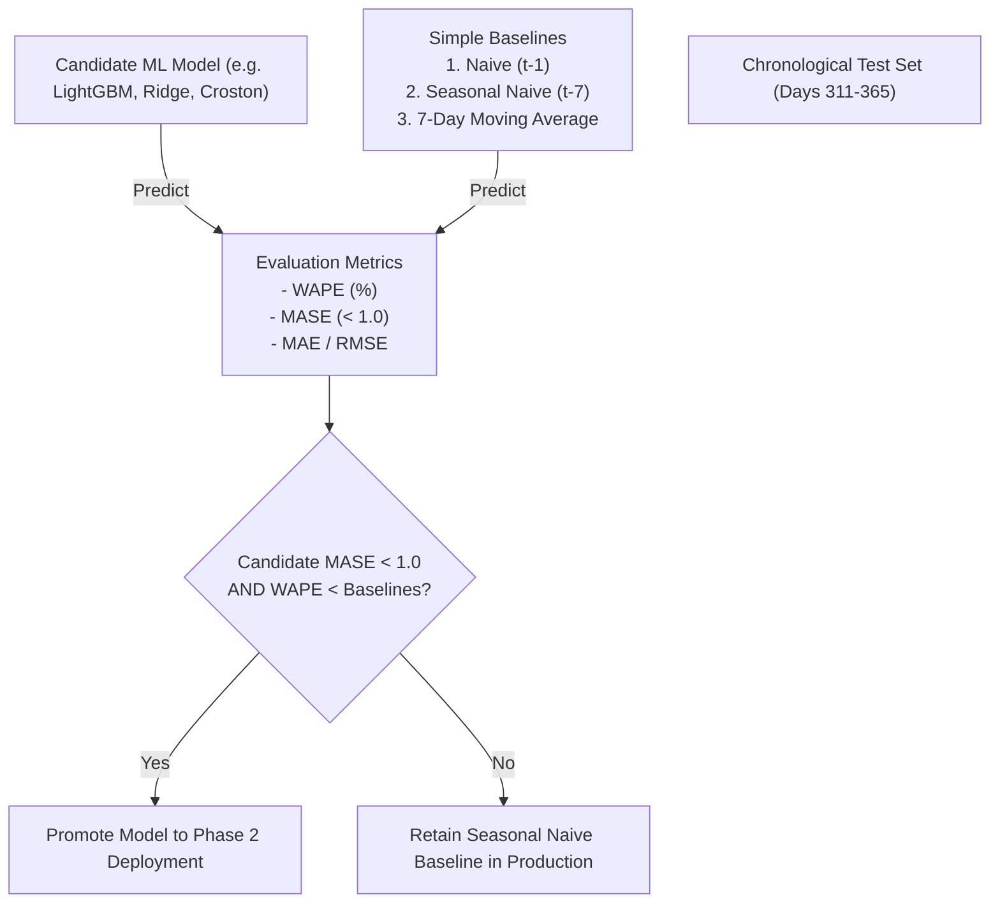

# Machine Learning Model Evaluation & Baseline Comparison Plan

**Project**: AI-Powered Food Waste Management Platform for Surplus Identification and Redistribution Optimization  
**Milestone**: 2 — Machine Learning Demand Forecasting & Food Waste Prediction  
**Phase**: Phase 1 — Dataset Audit, Raw Data Profiling and ML Pipeline Design  
**Date**: October 23, 2026  
**Auditor**: Senior Machine Learning Engineer, Statistical Evaluator  

---

## 1. Evaluation Philosophy & Benchmarking Hierarchy

In production forecasting, complex machine-learning architectures (e.g. Deep Neural Networks, Prophet) must **never** be assumed to outperform simpler baselines without empirical proof. Every candidate model must compete against simple, transparent statistical baselines on identical, fixed chronological test partitions.

---

## 2. Baseline Model Specifications

All baselines are implemented and verified in [`backend/app/ml/baselines.py`](file:///D:/Waste%20management/backend/app/ml/baselines.py):

### 2.1 Baseline 1: Naive Forecast (Persistence)
- **Formulation**: Forecast equals the most recently observed value:
  $$\hat{y}_{t+h} = y_t$$
- **Purpose**: Establishes the absolute minimum performance benchmark. Any machine learning model that fails to beat the Naive forecast is mathematically detrimental.

### 2.2 Baseline 2: Seasonal Naive Forecast (Weekly Cycle)
- **Formulation**: Forecast equals the value observed exactly one seasonal cycle (7 days) prior:
  $$\hat{y}_{t+h} = y_{t+h-7}$$
- **Purpose**: Extremely effective in retail environments with strong day-of-week shopping patterns (e.g., Saturday rushes, Monday slumps).

### 2.3 Baseline 3: Rolling Moving Average (7-Day Mean)
- **Formulation**: Forecast equals the arithmetic mean of the past 7 days:
  $$\hat{y}_{t+h} = \frac{1}{7}\sum_{i=0}^6 y_{t-i}$$
- **Purpose**: Establishes a smooth trend baseline that dampens random daily variance.

---

## 3. Candidate Model Architectures & Selection Criteria

### 3.1 Tier 1: Machine Learning & Regularized Regressors (Phase 2 Focus)
1. **Ridge / Lasso Regression**: Linear model with $L_2$ or $L_1$ regularization over the 15 engineered lag, rolling, and calendar features. Fast, interpretable, immune to extreme variance.
2. **LightGBM / Gradient Boosted Trees (GBDT)**: Tree-based ensemble capable of capturing non-linear interactions between day-of-week, shelf-life, and recent demand momentum without requiring feature normalization.
3. **Croston's Method for Intermittent Demand**: Dedicated model for sparse SKUs (`PAN-TRUF-01`, `SEA-CAVI-01`), predicting demand size and inter-arrival probability separately.

### 3.2 Tier 2: Evaluation of Complex Models (Prophet, LSTM)
- **Facebook Prophet Assessment**:
  - *Data Requirement*: Requires at least 2 full annual cycles (730+ days) of daily history to reliably estimate multi-year trend changes and holiday effects.
  - *Verdict*: With 365 days of observation, Prophet introduces significant risk of overfitting trend changepoints while consuming $20\times$ the compute resources of LightGBM.
- **Deep Learning (LSTM / GRU) Assessment**:
  - *Data Requirement*: Recurrent neural networks typically require hundreds of thousands of sequences across multi-store chains to outperform gradient boosted trees.
  - *Verdict*: For single-tenant or store-level daily forecasting with $<10,000$ rows, LSTMs suffer from severe sample inefficiency, slow training, and lack of explainability.
- **Policy Rule**: Tier 1 models (GBDT and Ridge) will be evaluated first. Prophet or LSTM will only be explored if Tier 1 models fail to beat the Seasonal Naive baseline.

---

## 4. Evaluation Metrics & Sparsity Robustness

Standard Mean Absolute Percentage Error (MAPE) is mathematically invalid for retail inventory data because division by zero occurs whenever $y_t = 0$:
$$\text{MAPE} = \frac{1}{n}\sum \left|\frac{y - \hat{y}}{y}\right| \quad (\text{Explodes when } y = 0)$$

The evaluation pipeline implements four robust alternative metrics:

### 4.1 Weighted Absolute Percentage Error (WAPE)
$$\text{WAPE} = \frac{\sum_{t=1}^n |y_t - \hat{y}_t|}{\sum_{t=1}^n y_t}$$
- **Why It Matters**: Sums absolute errors across the entire period and divides by total actual sales. Perfectly handles days with zero sales without mathematical singularity.
- **Interpretation**: Expressed as a percentage (lower is better).

### 4.2 Mean Absolute Scaled Error (MASE)
$$\text{MASE} = \frac{\frac{1}{n}\sum_{t=1}^n |y_t - \hat{y}_t|}{\frac{1}{N-1}\sum_{i=2}^N |y_i - y_{i-1}|}$$
- **Why It Matters**: Recommended by Hyndman & Koehler (2006). Divides the model's test MAE by the in-sample mean absolute error of the one-step naive benchmark.
- **Interpretation**:
  - $\text{MASE} < 1.0$: Model outperforms the naive baseline.
  - $\text{MASE} > 1.0$: Model is worse than simply guessing yesterday's value.

### 4.3 Mean Absolute Error (MAE) & Root Mean Squared Error (RMSE)
- **MAE**: Average absolute error in units sold. Robust to isolated outliers.
- **RMSE**: Penalizes large forecasting errors quadratically, critical for preventing catastrophic stockouts on high-volume items.

---

## 5. Slice-Based Error Analysis & Model Promotion Criteria

Model performance will not be evaluated solely as a single global average. Slice-based evaluation will be performed across three dimensions:

1. **Category Perishability Slice**:
   - Highly Perishable (Meat, Seafood, Produce, Bakery): Evaluates short-term 1–3 day accuracy to protect against food spoilage.
   - Long Shelf-Life (Pantry, Frozen, Beverages): Evaluates weekly volume accuracy.
2. **Demand Pattern Slice (Syntetos-Boylan)**:
   - Smooth items vs Intermittent / Lumpy items.
3. **Volume Slice**:
   - Top 20% revenue drivers (A-items in ABC analysis) vs bottom 50% slow movers.

### Production Promotion Criteria (Acceptance Gate for Phase 2):
A candidate model will only be promoted to production if it satisfies all three conditions:
1. $\text{MASE}_{\text{test}} < 1.0$ across the majority of SKU categories.
2. $\text{WAPE}_{\text{test}} \le \text{WAPE}_{\text{SeasonalNaive}} - 2.0\%$ (statistically meaningful improvement over seasonal naive).
3. Inference latency under **25 ms** per SKU to support real-time replenishment dashboards.
