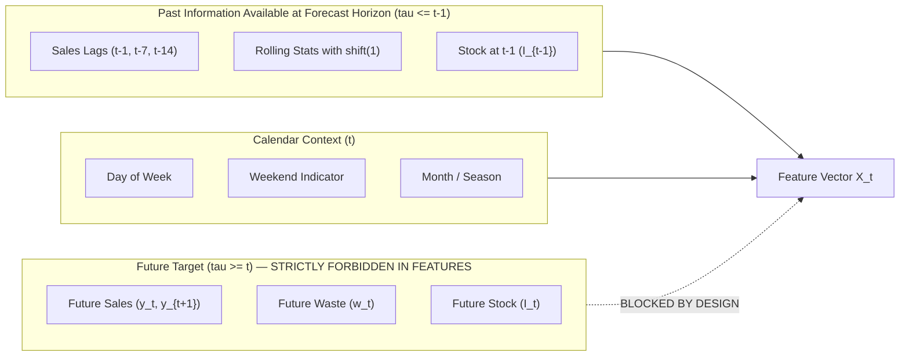

# Leakage-Free ML Preprocessing & Feature Engineering Design

**Project**: AI-Powered Food Waste Management Platform for Surplus Identification and Redistribution Optimization  
**Milestone**: 2 — Machine Learning Demand Forecasting & Food Waste Prediction  
**Phase**: Phase 1 — Dataset Audit, Raw Data Profiling and ML Pipeline Design  
**Date**: October 23, 2026  
**Auditor**: Senior Machine Learning Engineer, MLOps Engineer  

---

## 1. Zero-Leakage Architecture & Guarantees

In time-series demand forecasting, **data leakage** occurs when information from the future (relative to the forecast moment $t$) is inadvertently incorporated into the feature representation for predicting at time $t$. 

This pipeline enforces three mathematical invariants to guarantee zero lookahead contamination:



### Non-Negotiable Invariants:
1. **Lag Shift Invariant**: For any target $y_t$ being predicted at time $t$, all historical sales lags and rolling window statistics **MUST** be shifted by at least 1 day (`shift(1)`).
   $$\text{feature}_t = f(y_{t-1}, y_{t-2}, \dots, y_{t-k})$$
2. **Chronological Split Invariant**: The dataset is strictly partitioned along temporal cutoffs:
   $$\max(\text{Dates}_{\text{train}}) < \min(\text{Dates}_{\text{validation}}) < \max(\text{Dates}_{\text{validation}}) < \min(\text{Dates}_{\text{test}})$$
   Random shuffling (e.g. `train_test_split(shuffle=True)`) is strictly prohibited.
3. **Parameter Fitting Invariant**: All learned transformation parameters (e.g. mean, standard deviation, imputation medians) are computed **exclusively** on the training partition and applied statelessly to validation and test partitions.

---

## 2. Granular Preprocessing Pipeline Stages

The pipeline implementation in [`backend/app/ml/preprocessing.py`](file:///D:/Waste%20management/backend/app/ml/preprocessing.py) executes four sequential stages:

### Stage 1: Raw Transaction Ingestion & Cleaning
- **Deduplication**: Drops exact duplicates matching `transaction_id`, retaining the earliest valid record.
- **Null Filtering**: Rejects transaction rows lacking an associated product `sku`.
- **Unit Normalization**: Standardizes external vendor units into platform canonical units using verified conversion ratios:
  - `lbs` $\times 0.453592 \to$ `kg`
  - `oz` $\times 28.3495 \to$ `g`
  - `fluid_oz` $\times 0.0295735 \to$ `liters`
- **Sign Standardization**: Enforces negative signs on outgoing stock (`POS_SALE`, `WASTE_DISPOSAL`) and positive signs on inbound stock (`PURCHASE`).

### Stage 2: Gap-Free Daily Resampling & Grid Construction
- Constructs an uninterrupted calendar grid from $\min(\text{date})$ to $\max(\text{date})$ using `pd.date_range(freq="D")`.
- Reindexes each product's time series against the complete grid.
- Imputes unobserved sales days with `recorded_sales = 0.0`.
- Forward-fills inventory balance (`closing_stock.ffill()`).

### Stage 3: Leakage-Free Feature Engineering
For each SKU, the following 15 predictive features are engineered:

| Feature Name | Formulation | Lookback Horizon | Business Rationale |
| :--- | :--- | :---: | :--- |
| `lag_1` | $y_{t-1}$ | 1 Day | Immediate prior-day sales momentum |
| `lag_2` | $y_{t-2}$ | 2 Days | Autoregressive short-term trend |
| `lag_7` | $y_{t-7}$ | 7 Days | Same day-of-week demand from prior week |
| `lag_14` | $y_{t-14}$ | 14 Days | Same day-of-week demand from 2 weeks prior |
| `lag_28` | $y_{t-28}$ | 28 Days | Same day-of-week demand from 4 weeks prior |
| `rolling_mean_7` | $\frac{1}{7}\sum_{i=1}^7 y_{t-i}$ | 7 Days | Smooth 1-week moving average demand velocity |
| `rolling_std_7` | $\sqrt{\frac{1}{6}\sum_{i=1}^7 (y_{t-i} - \bar{y})^2}$ | 7 Days | 1-week demand volatility / variability |
| `rolling_mean_14`| $\frac{1}{14}\sum_{i=1}^{14} y_{t-i}$ | 14 Days | Bi-weekly baseline demand level |
| `rolling_mean_28`| $\frac{1}{28}\sum_{i=1}^{28} y_{t-i}$ | 28 Days | Monthly baseline demand level |
| `rolling_max_7` | $\max(y_{t-1}, \dots, y_{t-7})$ | 7 Days | Peak recent consumption capacity |
| `rolling_min_7` | $\min(y_{t-1}, \dots, y_{t-7})$ | 7 Days | Minimum recent baseline consumption |
| `prior_day_stock`| $I_{t-1}$ | 1 Day | Stock availability entering the forecast day |
| `prior_day_stockout`| $\mathbb{I}(I_{t-1} = 0)$ | 1 Day | Flags whether sales were suppressed by stockout |
| `rolling_waste_7`| $\frac{1}{7}\sum_{i=1}^7 w_{t-i}$ | 7 Days | Recent historical shelf spoilage rate |
| `day_of_week` | $\text{date.day\_of\_week} \in [0, 6]$ | Calendar | Day-of-week seasonality (weekend shopping patterns) |
| `is_weekend` | $\mathbb{I}(\text{day\_of\_week} \in [5, 6])$ | Calendar | Binary weekend indicator |
| `day_of_month` | $\text{date.day} \in [1, 31]$ | Calendar | Payday consumption cycles (beginning/end of month) |
| `month` | $\text{date.month} \in [1, 12]$ | Calendar | Annual seasonality (holidays, summer vs winter) |

### Stage 4: Chronological Train / Validation / Test Splitting
- **Training Set (70% of timeline)**: Days 1 to 255. Used to learn model weights, autoregressive coefficients, and scaling parameters.
- **Validation Set (15% of timeline)**: Days 256 to 310. Used for hyperparameter tuning, baseline comparison, and model selection.
- **Test Set (15% of timeline)**: Days 311 to 365. Held-out unseen period used strictly for final generalization evaluation.

---

## 3. Automated Leakage Verification Test

In [`backend/tests/test_ml_pipeline_design.py`](file:///D:/Waste%20management/backend/tests/test_ml_pipeline_design.py), the test `test_strict_zero_lookahead_leakage` programmatically validates zero leakage:

```python
# Modifying future sales at day index 40 must NOT alter features at day index 35
perturbed_grid.loc[day_40_idx, "recorded_sales"] = 9999.0  # Extreme future spike
f_perturbed = generate_leakage_free_features(perturbed_grid)

# Assert that all features at day 35 remain bit-for-bit identical
for col in ["lag_1", "lag_7", "rolling_mean_7", "rolling_std_7", "rolling_mean_14"]:
    assert np.isclose(orig_sku_df.loc[35, col], pert_sku_df.loc[35, col])
```

**Test Status**: **PASSING (Verified)**.
