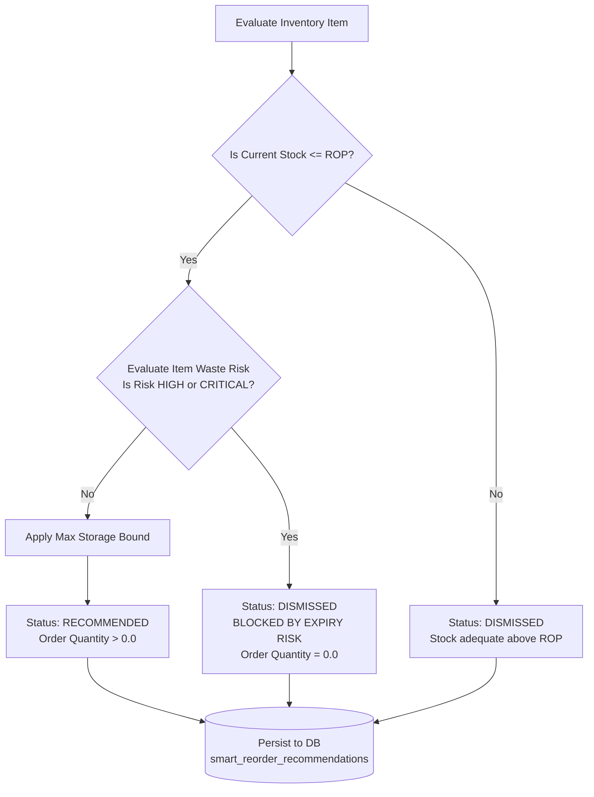

# Smart Replenishment & Reorder Recommendation Engine Specification

## 1. Executive Summary & Purpose
The **Smart Replenishment & Reorder Recommendation Engine** delivers AI-driven, inventory-aware purchase order suggestions. It balances stockout prevention with perishability risk.

Traditional reorder engines assume non-perishable goods and trigger automatic purchase orders whenever inventory falls below a static threshold. In grocery and food retail, blindly reordering an item that already has surplus expiring batches directly leads to spoilage and compound food waste. 

The Smart Reorder Engine solves this through:
1. Dynamic, demand-forecasted Reorder Points ($ROP$).
2. Statistical Safety Stock ($SS$) calibrated to a 95% service level ($Z=1.65$).
3. Warehouse and shelf physical storage capacity boundaries.
4. **Mandatory Expiry Risk Guard**: Automated suppression of replenishment orders if the SKU is currently flagged with `HIGH` or `CRITICAL` surplus risk.

---

## 2. Mathematical Replenishment Formulations

### 2.1 Lead-Time Demand ($D_{lead}$)
Expected consumer demand across the vendor procurement lead time ($L_{days}$):
$$D_{lead} = \hat{d}_{daily} \times L_{days}$$
Where $\hat{d}_{daily}$ is derived from the ML 1-day or 7-day model.

### 2.2 Dynamic Safety Stock ($SS$)
Statistical buffer to absorb demand variance during vendor delivery lead times:
$$SS = Z \times \sqrt{L_{days}} \times \sigma_{daily}$$
- **$Z = 1.65$**: Corresponds to a 95% cycle service level (normal distribution $z$-score).
- **$L_{days}$**: Supplier replenishment lead time in days (default: 2 days).
- **$\sigma_{daily}$**: Daily demand standard deviation for the SKU (default fallback: 2.0 units).

### 2.3 Dynamic Reorder Point ($ROP$)
The inventory threshold triggering replenishment consideration:
$$ROP = D_{lead} + SS$$

### 2.4 Target Stock Level ($S_{target}$)
The replenishment target covering both lead time and the regular review period ($R_{days} = 7$ days):
$$S_{target} = D_{lead} + SS + (\hat{d}_{daily} \times R_{days})$$

### 2.5 Storage Capacity Guard ($Q_{max}$)
To prevent physical warehouse overfill, the maximum permissible stock cannot exceed a multiple of weekly demand:
$$Q_{max} = \text{MAX\_STORAGE\_FACTOR} \times (\hat{d}_{daily} \times 7)$$
Default factor is $3.0\times$ weekly demand.

### 2.6 Recommended Order Quantity ($Q_{order}$)
When current stock $Q_{current} \le ROP$:
$$Q_{order} = \max\left(0.0, \; \min\left(S_{target} - Q_{current}, \; Q_{max} - Q_{current}\right)\right)$$

---

## 3. The Expiry Risk Suppression Guard



### The Waste Compounding Problem:
If a supermarket has 40 units of heavy cream expiring in 2 days and daily velocity is 5 units/day, the store will suffer 30 units of surplus waste. If a reorder rule triggers simply because stock is low against weekly cover, 50 fresh units would arrive just as 30 units expire, clogging shelf space and accelerating markdown write-offs.

### The Guard Mechanism:
Before issuing a `RECOMMENDED` status, the Smart Reorder Engine executes a waste-risk assessment:
1. If the item's risk tier is **`HIGH`** or **`CRITICAL`**, the reorder is immediately blocked:
   - `recommended_reorder_quantity = 0.0`
   - `is_blocked_by_expiry_risk = True`
   - `status = "DISMISSED"`
   - `reason = "REORDER SUPPRESSED: Item currently at CRITICAL waste risk (days to expiry: 2.0). Resolve existing surplus before reordering."`
2. This guard completely prevents automated over-ordering of distressed inventory lines.

---

## 4. Human-in-the-Loop Safety Boundaries

To adhere strictly to platform governance:
- **No Automated Vendor Purchase Orders**: The system generates actionable *recommendations*, never automated external financial commitments.
- **No Automated Inventory Mutations**: The reorder service does NOT mutate physical inventory stock balances or adjust item quantities. Physical adjustments occur solely via the approved stock transaction service during actual receiving.
- **Auditable Records**: All recommendations are stored in `smart_reorder_recommendations` with the exact calculation parameters ($ROP, SS, D_{lead}$) for full operational transparency.

---

## 5. Database Schema

```sql
CREATE TABLE smart_reorder_recommendations (
    id VARCHAR(36) PRIMARY KEY,
    tenant_id VARCHAR(36) NOT NULL REFERENCES tenants(id),
    item_id VARCHAR(36) NOT NULL REFERENCES inventory_items(id),
    sku VARCHAR(100),
    current_stock NUMERIC(10, 2) NOT NULL,
    predicted_daily_demand NUMERIC(10, 2) NOT NULL,
    lead_time_days INTEGER NOT NULL DEFAULT 2,
    safety_stock NUMERIC(10, 2) NOT NULL,
    reorder_point NUMERIC(10, 2) NOT NULL,
    recommended_reorder_quantity NUMERIC(10, 2) NOT NULL,
    status VARCHAR(20) NOT NULL DEFAULT 'RECOMMENDED',
    reason TEXT,
    is_blocked_by_expiry_risk BOOLEAN NOT NULL DEFAULT FALSE,
    generated_at TIMESTAMP NOT NULL DEFAULT CURRENT_TIMESTAMP
);
```
