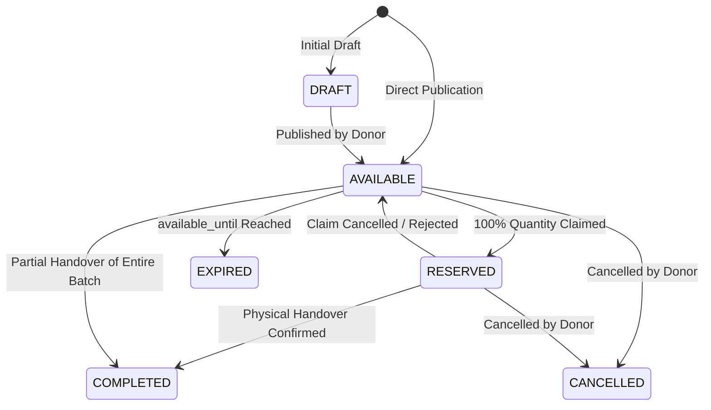

# Surplus Food Listing Workflow & Inventory Earmarking Specification

**Document Version:** 1.0.0  
**Phase:** Milestone 3 — Phase 1  
**Target Roles:** Food Businesses, Supermarkets, Bakeries, Restaurants, Wholesalers

---

## 1. Overview & Business Objective

The **Surplus Listing Engine** enables retail food businesses to earmark expiring or excess commercial inventory for rescue and donation by qualified non-governmental organizations (NGOs), community kitchens, homeless shelters, and food banks.

### Core Architecture Principles
1. **Zero Double-Allocation / Anti-Oversubscription:** A business cannot list more food than is unreserved in physical on-hand stock.
2. **Food Safety Gate:** Expired food (`expiry_date <= today`) or food with inadequate remaining shelf-life cannot enter the surplus redistribution channel.
3. **Atomic Earmarking vs. Physical Stock Deduction:** Earmarking holds commercial inventory in reserve (`DONATION_HOLD`) while remaining in physical custody. Stock is mathematically deducted from inventory via an immutable ledger entry (`DONATION_DISPATCH`) only upon confirmed physical handover.
4. **Tenant Isolation:** Donors manage and view their own listings; recipient NGOs search and view available donation listings across verified donors.

---

## 2. Listing Lifecycle State Machine

### State Definitions
- **`DRAFT`:** Listing saved internally, not yet visible on the NGO marketplace.
- **`AVAILABLE`:** Published to the NGO marketplace; eligible NGOs can submit claims up to the remaining claimable balance.
- **`RESERVED`:** 100% of the listed quantity has been requested or approved by recipient NGOs.
- **`COMPLETED`:** Physical pickup confirmed. Inventory has been permanently deducted via `DONATION_DISPATCH`.
- **`CANCELLED`:** Donor withdrew the listing. Earmarked stock is released back to commercial inventory; any pending claims are cancelled with notifications sent.
- **`EXPIRED`:** The donation collection window (`available_until`) has elapsed without collection.

---

## 3. Mathematical Inventory Reconciliation & Oversubscription Prevention

### Available-to-List Formula
For an inventory item $i$ belonging to donor tenant $T$ with physical current quantity $Q_{\text{physical}}(i)$:

$$Q_{\text{earmarked}}(i) = \sum_{L \in \text{Listings}(i, \text{status} \in \{\text{AVAILABLE}, \text{RESERVED}\})} Q(L)$$

$$Q_{\text{available\_to\_list}}(i) = Q_{\text{physical}}(i) - Q_{\text{earmarked}}(i)$$

If a new listing or quantity update requests $Q_{\text{req}} > Q_{\text{available\_to\_list}}(i)$, the backend immediately rejects the transaction with an `InsufficientSurplusStockError` (HTTP 400).

### Remaining-Claimable-Quantity Formula
For an active listing $L$:

$$Q_{\text{claimed}}(L) = \sum_{C \in \text{Claims}(L, \text{status} \in \{\text{REQUESTED}, \text{APPROVED}, \text{COMPLETED}\})} Q(C)$$

$$Q_{\text{remaining\_claimable}}(L) = \max\left(0, Q(L) - Q_{\text{claimed}}(L)\right)$$

NGO claims are rejected if $Q_{\text{claim}} > Q_{\text{remaining\_claimable}}(L)$.

---

## 4. Food Safety Gates & Validation Rules

| Constraint | Validation Rule | Error Raised |
| :--- | :--- | :--- |
| **Past Expiration** | `expiry_date < today_utc` | `FoodSafetyValidationError: Cannot list expired food` |
| **Elapsed Window** | `available_until <= now_utc` | `FoodSafetyValidationError: available_until must be in the future` |
| **Window Boundary** | `available_until > available_from` | `Pydantic CheckConstraint: chk_surplus_window` |
| **Positive Quantity** | `quantity > 0` | `CheckConstraint: chk_surplus_qty_positive` |
| **Cold-Chain Continuity** | `storage_requirement` matches item requirement | Hard-coded inheritance from inventory item |
| **Role Authorization** | Donor must have `BUSINESS_OWNER`, `STORE_MANAGER`, or `INVENTORY_STAFF` | HTTP 403 Forbidden |

---

## 5. Audit Logging & In-App Notifications

Every lifecycle event records an immutable `AuditEvent`:
- `SURPLUS_LISTING_CREATE`: Donor ID, product name, quantity, available_until.
- `SURPLUS_LISTING_UPDATE`: Delta changes and updated quantity.
- `SURPLUS_LISTING_CANCEL`: Cancellation reason and released hold units.

Simultaneously, `SurplusNotification` records are pushed to:
- Matched NGOs when a new high-fit listing is published.
- Donors when an NGO submits a claim request.
- NGOs when a claim is approved, declined, or cancelled.
