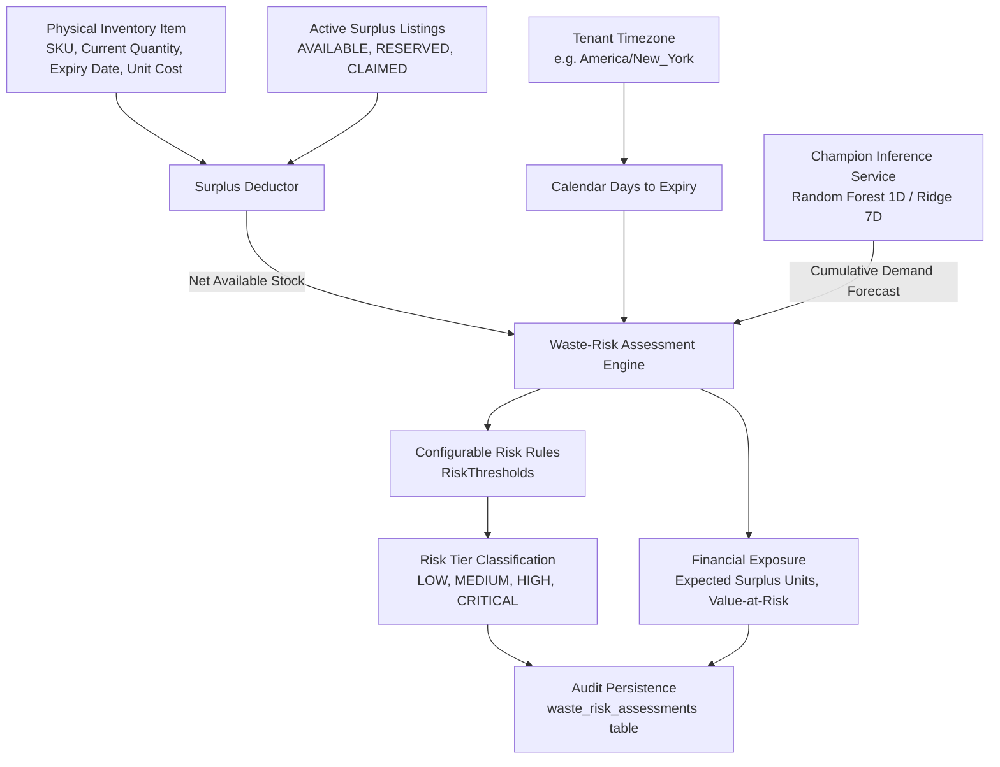

# Perishable Waste-Risk Assessment Engine Specification

## 1. Executive Summary & Purpose
The **Perishable Waste-Risk Assessment Engine** evaluates physical inventory lots against machine-learned consumer demand trajectories to quantify the likelihood and financial exposure of unsold, expiring perishable food. 

By comparing remaining shelf life against multi-horizon cumulative sales forecasts, the engine categorizes every on-hand stock batch into one of four explainable risk tiers (`LOW`, `MEDIUM`, `HIGH`, `CRITICAL`), computes **Value-at-Risk ($VaR$)**, and triggers actionable operational interventions:
1. Dynamic retail price markdowns (for moderate risk items).
2. Proactive surplus routing and NGO donation dispatch (for imminent expiration items).

---

## 2. Core Inputs & Data Flow



### Primary Parameters:
1. **$Q_{physical}$**: Current physical on-hand quantity recorded in inventory.
2. **$Q_{reserved}$**: Stock already committed to active donation or redistribution listings (`AVAILABLE`, `RESERVED`, `CLAIMED`).
3. **$Q_{available} = \max(0, Q_{physical} - Q_{reserved})$**: Net physical stock subject to retail spoilage.
4. **$T_{expiry}$**: Calendar days remaining until batch expiration, anchored to tenant local timezone:
   $$\Delta_{days} = \text{expiry\_date} - \text{today\_local}$$
5. **$\hat{D}(\Delta_{days})$**: ML-predicted cumulative consumer demand from now until expiration.
6. **$C_{unit}$**: Unit acquisition cost from the inventory record.

---

## 3. Mathematical Formulations

### 3.1 Expected Surplus Quantity ($S_{expected}$)
The surplus quantity represents physical units expected to remain unsold at the point of expiration:
$$S_{expected} = \max\left(0.0, \; Q_{available} - \hat{D}(\Delta_{days})\right)$$

### 3.2 Surplus Ratio ($R_{surplus}$)
The proportion of current stock at risk of becoming waste:
$$R_{surplus} = \begin{cases} 
\frac{S_{expected}}{Q_{available}}, & \text{if } Q_{available} > 0 \\
0.0, & \text{otherwise}
\end{cases}$$

### 3.3 Value-at-Risk ($VaR$)
The unrecovered direct inventory capital at risk:
$$VaR = S_{expected} \times C_{unit}$$

---

## 4. Explainable Risk Classification Tiers

The engine classifies each item into one of four standardized risk tiers using deterministic, explainable heuristic thresholds:

| Risk Tier | Shelf-Life Urgency ($\Delta_{days}$) | Surplus Ratio ($R_{surplus}$) | Minimum Surplus Units | Primary Operational Recommendation |
| :--- | :--- | :--- | :--- | :--- |
| **`CRITICAL`** | $\le 2.0$ days ($\le 48\text{h}$) | $> 20\%$ | $\ge 0.5$ units | `DISPATCH_DONATION_IMMEDIATE`: Immediate packaging and transfer to surplus marketplace or partner food bank. |
| **`HIGH`** | $\le 5.0$ days | $> 25\%$ | $\ge 0.5$ units | `AGGRESSIVE_MARKDOWN_OR_DONATE`: Apply 40–50% discount or stage donation batch for upcoming redistribution pickup. |
| **`MEDIUM`** | $\le 10.0$ days | $> 15\%$ | $\ge 0.5$ units | `APPLY_DYNAMIC_MARKDOWN`: Apply 15–25% promotional markdown to accelerate daily velocity. |
| **`LOW`** | $> 10$ days OR $R_{surplus} \le 15\%$ | N/A | N/A | `NORMAL_RETAIL_OPERATIONS`: Retail demand is sufficient to absorb inventory prior to expiration. |

### Edge Case Handling & Fallbacks:
- **Zero or Negative Stock**: Classified as `LOW` (`ZERO_STOCK_NO_RISK`).
- **High Stock with Adequate Velocity**: If $Q_{available} = 500$ but $\hat{D}(\Delta_{days}) = 600$, $S_{expected} = 0$, resulting in `LOW` tier.
- **Rounding Dust Guard**: If $S_{expected} < 0.5$ units, the item is retained as `LOW` to prevent alert fatigue on negligible fractions.
- **Model Offline / Fallback**: If the ML model artifact is unavailable, the engine gracefully falls back to the `SeasonalNaive` baseline without breaking the pipeline.

---

## 5. Active Surplus Reservation Deduction

A critical architectural requirement is preventing double-counting of surplus stock. If a retail store has 50 units of yogurt expiring in 2 days, but 30 units are already listed or claimed on the surplus redistribution platform:
$$Q_{physical} = 50.0, \quad Q_{reserved} = 30.0 \implies Q_{available} = 20.0$$

The retail waste-risk engine only evaluates the remaining 20 units against commercial retail demand. Once a listing is finalized (`COMPLETED`), the physical stock is deducted from `InventoryItem` via normal stock transactions.

---

## 6. Audit Trail & Database Schema

Every evaluation (both real-time API calls and batch cron executions) can be persisted to the `waste_risk_assessments` table for compliance, historical trend analysis, and model performance tracking:

```sql
CREATE TABLE waste_risk_assessments (
    id VARCHAR(36) PRIMARY KEY,
    tenant_id VARCHAR(36) NOT NULL REFERENCES tenants(id),
    inventory_item_id VARCHAR(36) NOT NULL REFERENCES inventory_items(id),
    sku VARCHAR(100),
    current_stock NUMERIC(10, 2) NOT NULL,
    days_to_expiry NUMERIC(6, 2) NOT NULL,
    predicted_demand_to_expiry NUMERIC(10, 2) NOT NULL,
    expected_surplus_units NUMERIC(10, 2) NOT NULL,
    surplus_ratio NUMERIC(5, 3) NOT NULL,
    unit_cost NUMERIC(10, 2) NOT NULL,
    value_at_risk NUMERIC(10, 2) NOT NULL,
    risk_tier VARCHAR(20) NOT NULL,
    recommended_action VARCHAR(100) NOT NULL,
    model_name VARCHAR(100) NOT NULL,
    model_version VARCHAR(50) NOT NULL,
    assessed_at TIMESTAMP NOT NULL DEFAULT CURRENT_TIMESTAMP
);
```
